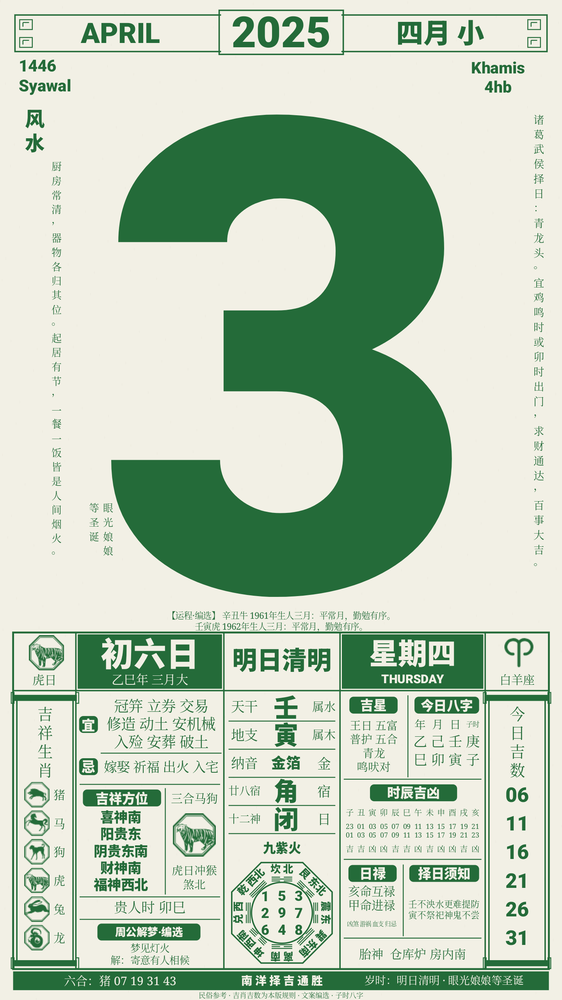
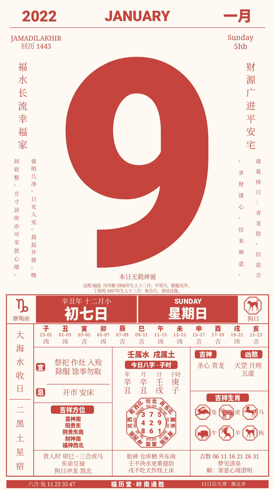
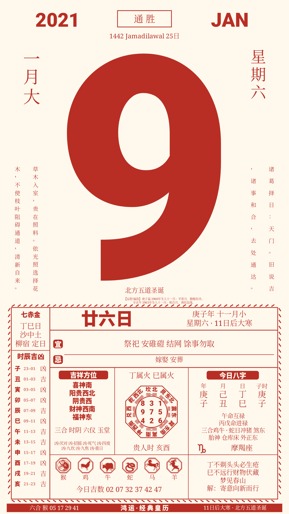
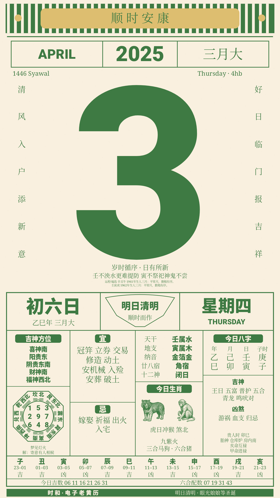
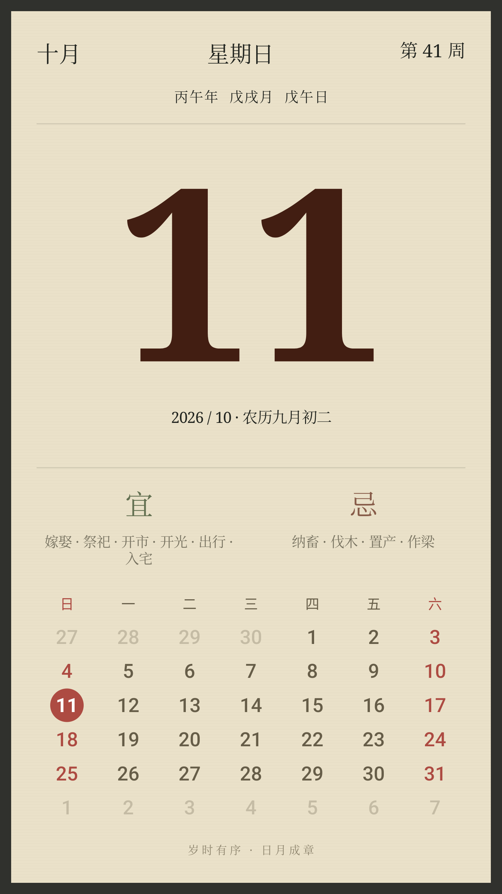
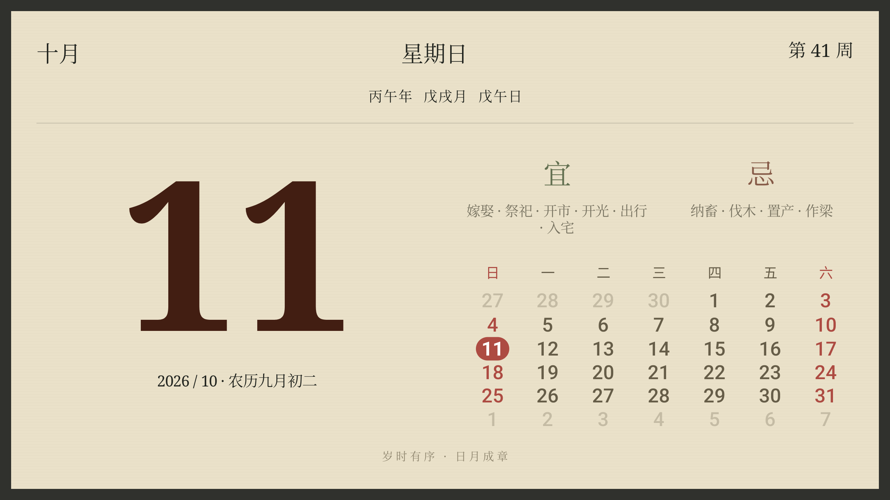

[中文](README.md) | [English](README.en.md)

# CalendarMods


**Keep a calendar you enjoy on your screen.**

CalendarMods combines Gregorian/lunar dates, solar terms and daily words in Eleven paper-inspired themes. Tap a preview to turn a phone or tablet into a fullscreen calendar that follows the day.

**Eleven themes · Immersive display · Midnight page turns · Personal photos · Offline**

Requires **Android 4.0 / API 14 or later**. This is the **compat** branch, implemented with framework Views and Canvas.

## A style for each day

Swipe between bright desk calendars, warm artwork, photographs, quiet vertical words and traditional almanacs.

| Theme | Appearance | Preview |
| --- | --- | --- |
| 晴日 / Golden | Yellow weekday strip and prominent date | [View](docs/screenshots/refinement-portrait-1-golden.jpg) |
| 冬日来信 / Winter Letter | Bear illustration and lunar month grid | [View](docs/screenshots/refinement-portrait-2-teddy.jpg) |
| 拾光 / Captured Light | Your photograph and a paper month grid | [View](docs/screenshots/refinement-portrait-3-photo.jpg) |
| 好日 / Good Day | Space, serif date and suitable-activity carousel | [View](docs/screenshots/refinement-portrait-4-good_day.jpg) |
| 慢笺 / Verse | Pale green paper and vertical daily words | [View](docs/screenshots/refinement-portrait-5-verse.jpg) |
| 岁时 / Almanac | Lunar dates, festivals and complete almanac entries | [View](docs/screenshots/refinement-portrait-6-almanac.jpg) |
| 一页 / One Page | Hanging binding, large date and cat line art | [View](docs/screenshots/refinement-portrait-7-hanging.jpg) |

## Four traditional almanacs

Nanyang, Lingnan, Classic and Shihe add large dates, bilingual weekdays, lunar stems/branches, complete almanac columns, twelve hours, nine palaces, travel-selection rules, zodiac numbers and folk editorial text. They share one offline engine, with per-theme ink, manual/scheduled/ambient dark mode and festival layouts. Shihe also has solar-term artwork. See [layout, sources and differences](docs/traditional-theme.en.md) and the [shared engine](docs/almanac-engine.en.md).

| Nanyang | Lingnan | Classic | Shihe |
| --- | --- | --- | --- |
|  |  |  |  |


## Tap to expand

Tap a calendar for a continuous preview-to-fullscreen transition, hiding status/navigation bars and chooser controls. Long press or system Back returns to the same preview. Fullscreen stays awake; leaving restores normal screen timeout. Ordinary taps/swipes do not accidentally switch themes. Rotation, resume and relaunch retain theme/display preferences.

Portrait resembles a complete sheet; landscape rearranges photo, date and grid into columns. Hidden navigation bars leave their space available to the page, while native safe areas protect cutouts and desktop captions on Compose branches.

| Portrait | Landscape |
| --- | --- |
|  |  |

## Fixed theme inventory

compat retains eleven built-ins and existing installed data, but has no theme store, favorites or free-ordering UI.


## Make it yours

Winter Letter and Captured Light accept local images, using crop, fit or stretch. Images/fill are saved independently per theme and can be reset. System selection avoids whole-photo-library access, and a private copy works offline. Themes with a bundled font catalog expose font samples and let users choose a bundled face, follow the author default or restore the template font; each theme retains its own preference. See [font development](docs/theme-fonts.en.md) for branch applicability.

The app follows device date/timezone, animates natural foreground midnight and refreshes directly on resume. Every theme independently saves Page Animation (on by default) and Interactive Calendar (off by default). Disabling animation changes dates directly. Interactive fullscreen swipes page Winter Letter/Captured Light by month and other themes by day. Return to Today restores the live date; long press still exits. These settings do not modify image/fill/font preferences.

Dates, weekdays, week numbers, lunar labels and today highlighting update together. Same-day terms and multiple festivals are retained. Good Day rotates individual suitable entries; One Page rotates groups; Almanac prints complete lists. There are 366 original sayings and 366 two-character Verse phrases, indexed continuously without a New Year reset. All data and words work offline, without network permission. Traditional suitability is presented as folk-calendar content.

## Start and download

1. Swipe to a theme.
2. Open its style control beside the title.
3. Tap the calendar for fullscreen.
4. Long press or use Back to return.

[](https://github.com/heyiWF/CalendarMods/actions/workflows/android.yml?query=branch%3Acompat)

Choose a successful **compat** run in [GitHub Actions](https://github.com/heyiWF/CalendarMods/actions/workflows/android.yml?query=branch%3Acompat), download `CalendarMods-debug-<run-number>` from Artifacts, extract and install `CalendarMods-debug.apk`. These are development-preview builds.

## Developer checks

```powershell
.\gradlew.bat --no-daemon testDebugUnitTest lintDebug assembleDebug assembleDebugAndroidTest
adb shell am instrument -w com.calendarmods.test/com.calendarmods.CompatAcceptance
```

Use Android Studio JBR and a local Android SDK. To avoid replacing existing app data, build with a quoted PowerShell property such as `'-Pcalendarmods.applicationId=com.calendarmods.audit'` and use matching app/test packages. See the [documentation index](docs/README.en.md), [theme contract](docs/theme-contract.en.md), [assets](docs/assets.en.md), [issues](https://github.com/heyiWF/CalendarMods/issues) and [MIT license](LICENSE).

Screenshots show the capture date; live content follows the device. Historical acceptance documents identify their date and device limits.
