# CalendarMods

**把一页喜欢的日历，留在屏幕上。**

CalendarMods 是一款专注于日历展示的 Android 应用。七种各具风格的纸质日历主题，将日期、农历、节气与每日文句放在一起；轻点进入全屏，让手机或平板成为一页随时间更新的日历。

**七种主题 · 主题商店 · 沉浸全屏 · 午夜翻页 · 自选照片 · 离线使用**

支持 **Android 12 及以上**。

## 七种风格，每天都能换一种心情

从明亮的黄页台历，到温暖的插画与照片，再到安静的竖排文句和复古黄历，左右滑动即可预览，选中喜欢的一页开始使用。

| 晴日 · 黄页台历 | 冬日来信 · 插画月历 | 拾光 · 照片台历 |
| --- | --- | --- |
| 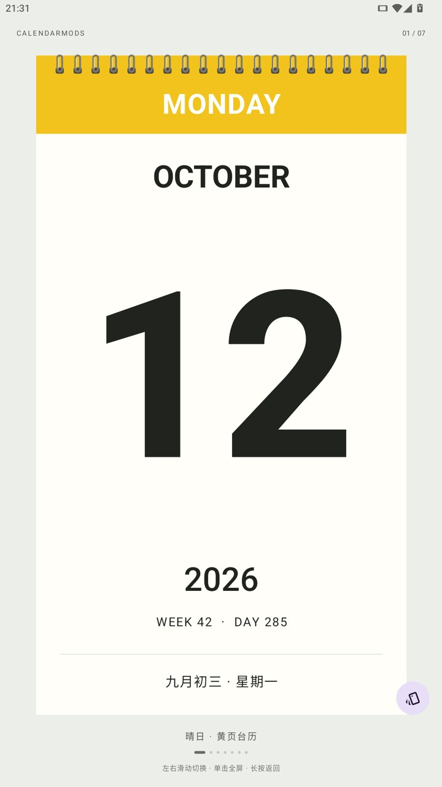 | 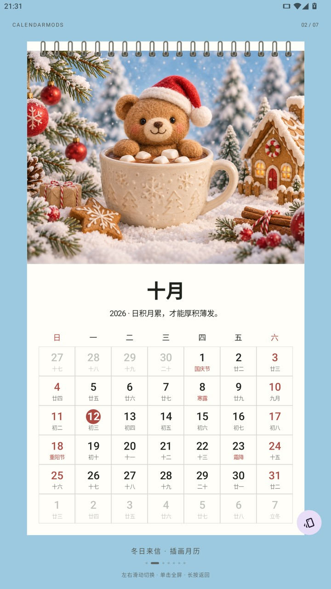 | 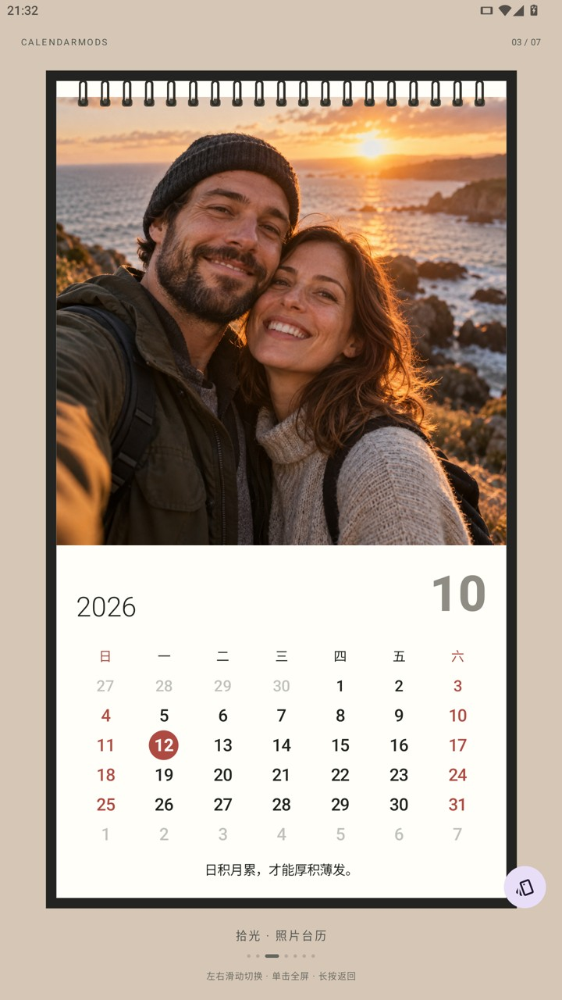 |
| 明亮的黄色星期条，搭配清晰醒目的大日期。 | 用一幅温暖插画，陪伴每天的日常。 | 把喜欢的照片，放进每天都会看到的日历。 |

| 好日 · 字体日历 | 慢笺 · 竖排文句 | 岁时 · 复古黄历 | 一页 · 悬挂日历 |
| --- | --- | --- | --- |
| 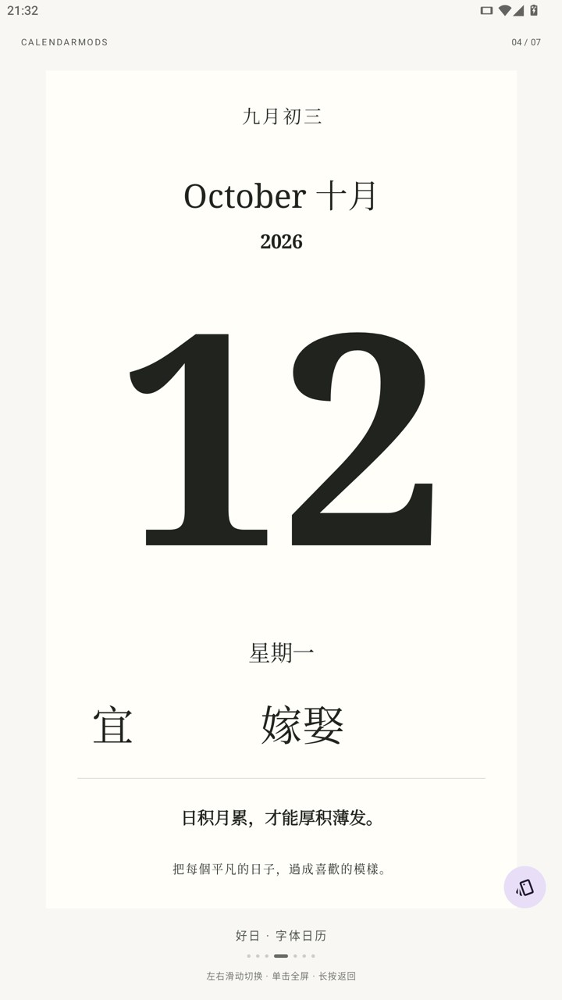 | 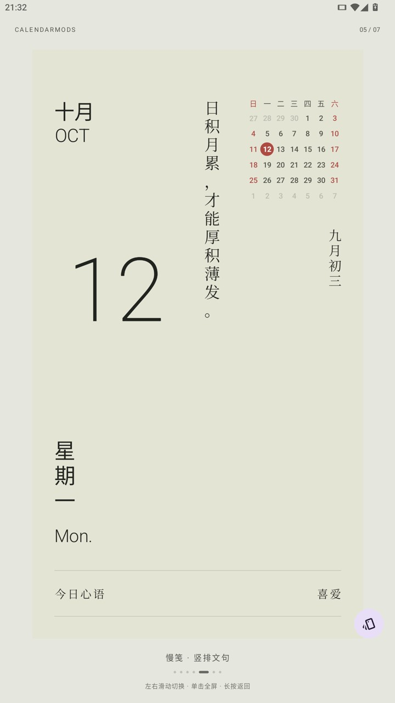 | 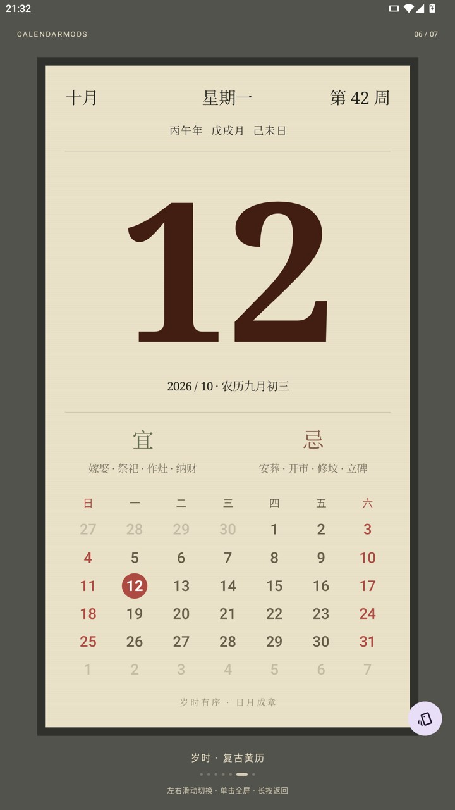 | 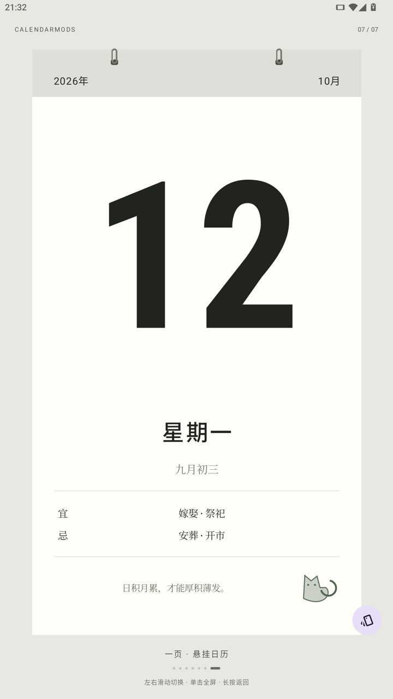 |
| 留白、衬线字体与缓缓切换的宜事项。 | 竖排短句与每日心语，留一点安静的空间。 | 农历、节日与完整宜忌，延续纸质黄历的熟悉感。 | 简洁的大日期，配上装订细节与小猫线稿。 |

## 轻点展开，专注于眼前这一页

单击日历，它会从预览平滑展开到全屏，隐藏状态栏、导航栏与选择控件。长按或使用系统返回键，日历便缩回原来的位置。

沉浸显示时屏幕保持常亮，适合放在桌面上随时查看。普通点击和滑动不会误切换主题，返回选择页后恢复正常熄屏。

横竖屏都有对应的布局：竖屏像一张完整纸页，横屏则将照片、日期和月历舒展地排在两侧。旋转屏幕、切到后台或重新打开，都会记住上次的主题与显示模式。

| 竖屏，一页完整的日历 | 横屏，舒展的桌面展示 |
| --- | --- |
| 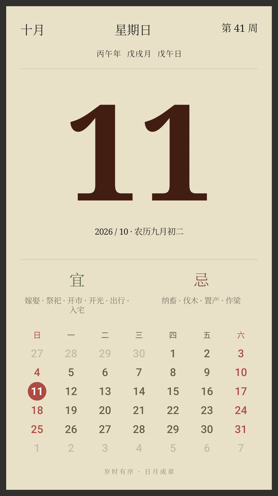 | 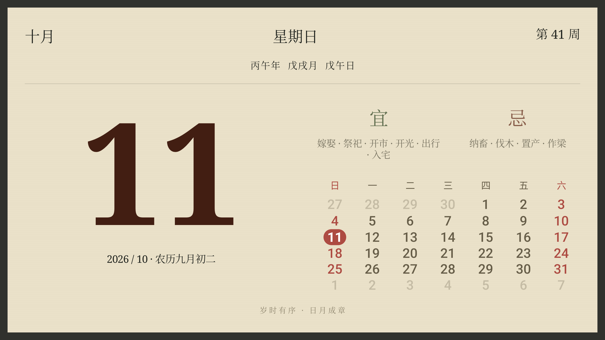 |

## 把喜欢的主题，收进自己的日历

滑到主题选择的最右侧，点击加号进入主题商店。推荐、收藏和已安装以三列预览展示，横竖屏都能浏览。

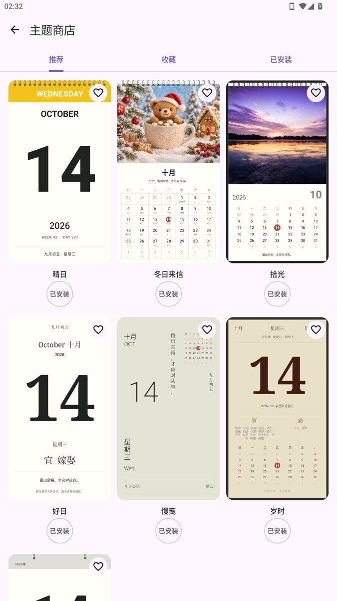 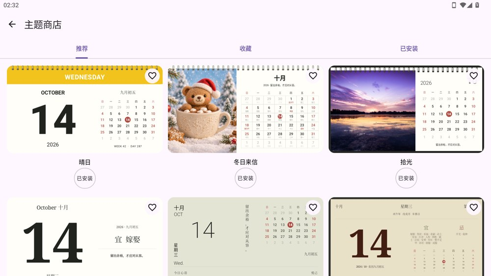

七个预设主题初始全部添加。收藏喜欢的外观，在“已安装”的编辑模式里拖动排序，让常用主题排在前面。也可以上滑切换页预览或在商店中删除主题；至少保留一个，删除的主题随时可以重新添加。

推荐和收藏页点击“应用”即可安装，再点“已安装”可以确认移除。在收藏页取消收藏后，卡片暂时保留，离开前再次点击心形即可撤销；切换标签或退出商店时保存。

删除会重置该主题的个人图片与样式，收藏仍然保留。重新添加的主题使用默认外观，排在列表最后。目前商店提供内置主题，无需联网。

## 让日历带上你的生活

“冬日来信”和“拾光”支持替换本机图片。可以放上旅行照片、喜欢的插画，或一张值得每天看见的合影。

- **三种图片填充方式**：等比填充、完整显示、拉伸填充，按画面选择合适的呈现方式。
- **每个主题独立保存**：照片与填充方式互不影响，切换回来仍是你的设置。
- **随时恢复默认**：想换回原来的样子，一次点击即可。

选取图片使用系统照片选择器，无需开放整个相册的访问权限。图片保存为应用内副本，离线也能显示。

## 日期之外，也有每天的新内容

CalendarMods 会随设备日期与时区更新。前台全屏跨过午夜时，七种主题会以各自的翻页、揭页或轻柔淡换迎接新的一天；从后台回来直接同步当前日期。

- **公历与农历同看**：日期、星期、周序、农历和月历高亮随当天变化。
- **节气与节日提醒**：展示当天的节气、传统节日和公历节日，同一天的多个节日一并保留。
- **传统宜忌**：“好日”逐项呈现，“一页”成组轮播，“岁时”完整展示，融入各自的版式。
- **每日原创文句**：366 条短格言与“慢笺”专属的 366 个二字心语，每天轮换，跨年不重置。

日期、历法与每日文句均可离线使用，应用无需联网权限。传统宜忌作为民俗历法内容展示。

## 开始使用

1. **左右滑动**，找到喜欢的主题。
2. **点击主题名称右侧的样式按钮**，查看当前主题的个性化选项。
3. **单击日历**，进入沉浸全屏。
4. **长按界面或按返回键**，回到主题选择页。

## 下载体验

前往 [安装包下载页面](https://github.com/heyiWF/CalendarMods/actions/workflows/android.yml)，选择一次成功的构建，在 **Artifacts** 中下载 `CalendarMods-debug-运行序号`，解压后安装 `CalendarMods-debug.apk`。

目前提供开发预览版 APK，支持 Android 12 及以上设备。

## 更多

- [反馈问题与建议](https://github.com/heyiWF/CalendarMods/issues)
- [主题扩展开发文档](docs/theme-contract.md)
- [素材与来源说明](docs/assets.md)
- [MIT 开源许可](LICENSE)

截图展示的是拍摄当天的内容，实际日历会随日期更新。
