[中文](README.md) | [English](README.en.md)

# CalendarMods


**把一页喜欢的日历，留在屏幕上。**

CalendarMods 是一款专注于日历展示的 Android 应用。十一种各具风格的纸质日历主题，将日期、农历、节气与每日文句放在一起；轻点进入全屏，让手机或平板成为一页随时间更新的日历。

**十一种主题 · 沉浸全屏 · 午夜翻页 · 自选照片 · 离线使用**

本分支保留 `pro` 新增的 **南洋 · 手撕通胜、福历 · 岭南通胜、鸿运 · 经典皇历、时和 · 电子老黄历**：米白纸面与绿色印刷，超大日期、双语星期、农历干支、宜忌、
十二时辰、九宫八卦、诸葛择日、生肖配数与民俗文案。各栏计算口径、来源及与纸历的差异见 [主题说明](docs/traditional-theme.md)。底栏以岁时摘要呈现节气、节日、神诞或物候。

支持 **Android 4.0（API 14）及以上**。`compat` 分支使用系统 View 与 Canvas 重写界面，不再依赖 Jetpack Compose。

## 十一种风格，每天都能换一种心情

从明亮的黄页台历，到温暖的插画与照片，再到安静的竖排文句和复古黄历，左右滑动即可预览，选中喜欢的一页开始使用。

截图更新于 **2026-11-10**，来自本分支最新构建。预览图保留右下角的样式设置按钮；全屏图单独展示。

| 晴日 · 黄页台历 | 冬日来信 · 插画月历 | 拾光 · 照片台历 |
| --- | --- | --- |
| 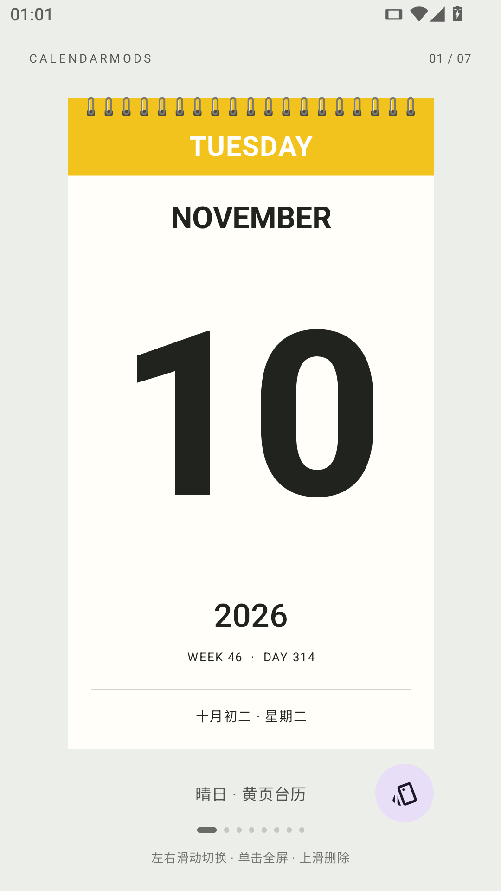 |  | 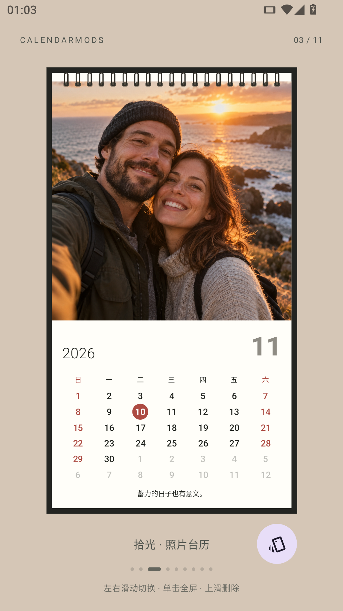 |
| 明亮的黄色星期条，搭配清晰醒目的大日期。 | 用一幅温暖插画，陪伴每天的日常。 | 把喜欢的照片，放进每天都会看到的日历。 |

| 好日 · 字体日历 | 慢笺 · 竖排文句 | 岁时 · 复古黄历 | 一页 · 悬挂日历 |
| --- | --- | --- | --- |
| 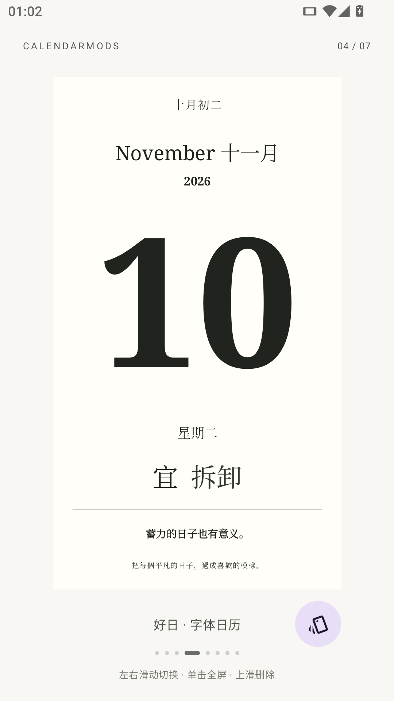 | 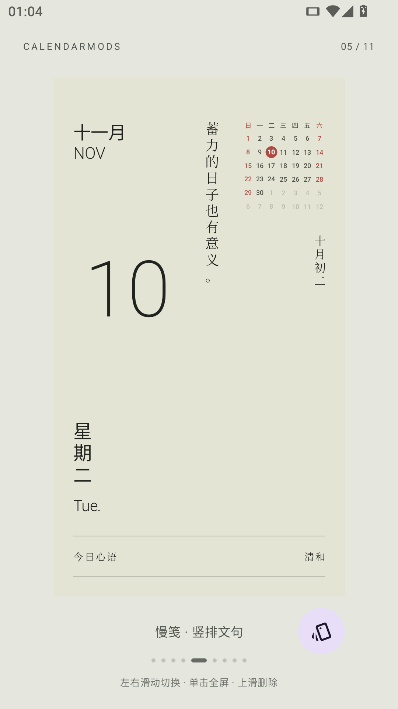 | 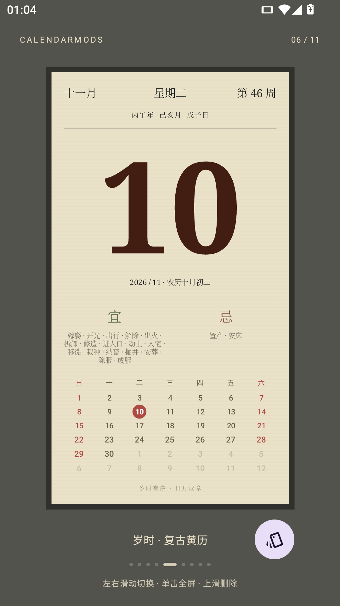 | 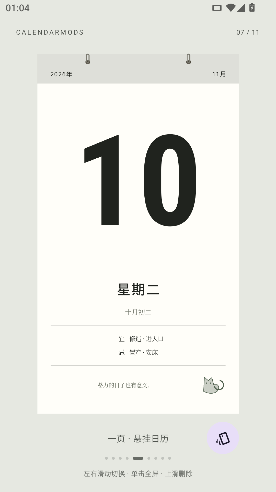 |
| 留白、衬线字体与缓缓切换的宜事项。 | 竖排短句与每日心语，留一点安静的空间。 | 农历、节日与完整宜忌，延续纸质黄历的熟悉感。 | 简洁的大日期，配上装订细节与小猫线稿。 |

## 四款老黄历

南洋手撕通胜、岭南通胜、经典皇历，以及参考 peitaiyi.com 的「时和 · 电子老黄历」，共用同一个离线黄历引擎。
可选择字体颜色、手动或定时深色模式；设备有光线传感器时，还可按持续环境亮度切换。
节日有专用版式，时和主题另外提供二十四节气插画；所有主题都有横屏布局。

| 南洋通胜 | 岭南通胜 | 经典皇历 | 时和老黄历 |
| --- | --- | --- | --- |
| 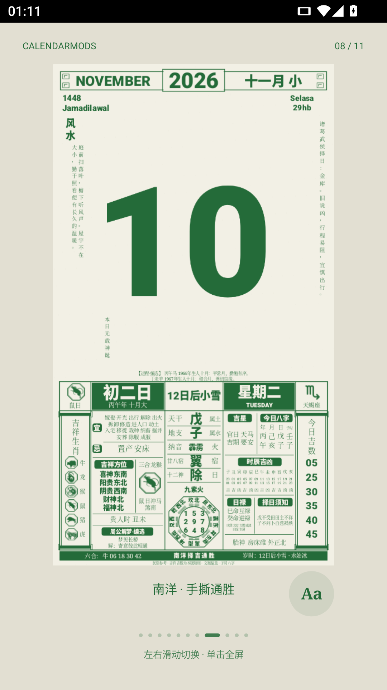 | 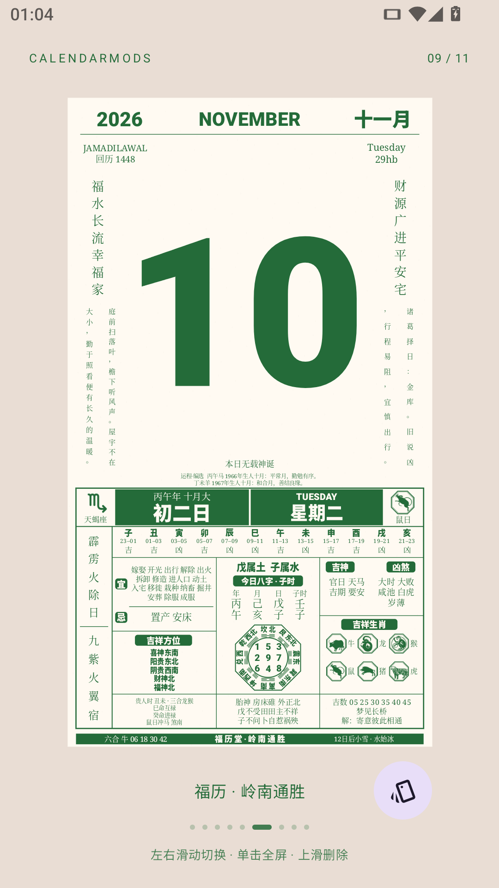 | 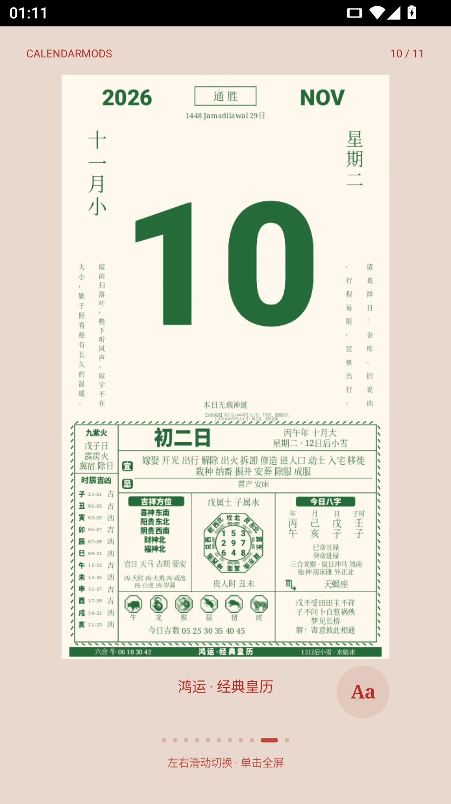 | 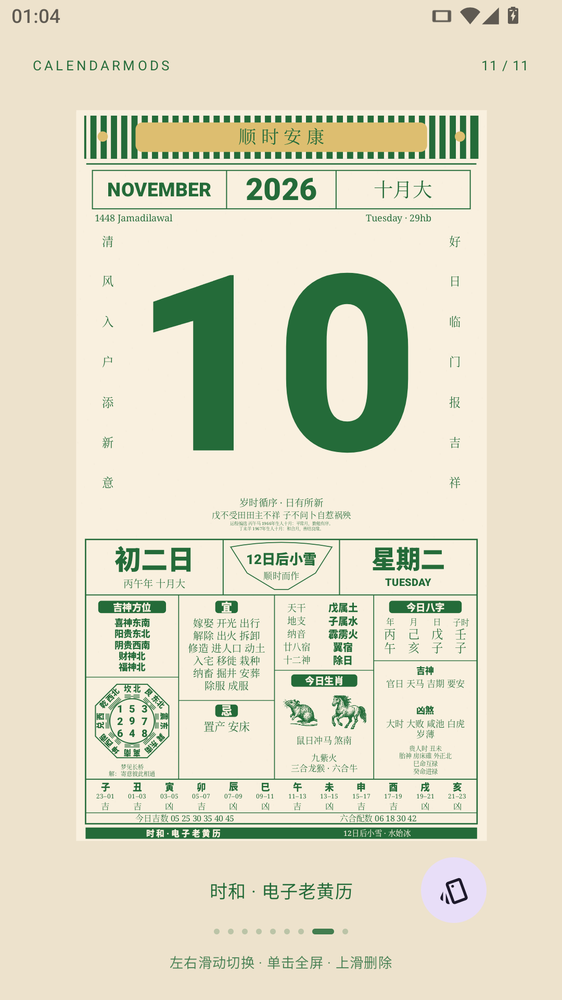 |

[主题与横屏、节日截图](docs/traditional-theme.md) · [共享黄历接口](docs/almanac-engine.md)

## 轻点展开，专注于眼前这一页

单击日历，它会从预览平滑展开到全屏，隐藏状态栏、导航栏与选择控件。长按或使用系统返回键，日历便缩回原来的位置。

沉浸显示时屏幕保持常亮，适合放在桌面上随时查看。普通点击和滑动不会误切换主题，返回选择页后恢复正常熄屏。

横竖屏都有对应的布局：竖屏像一张完整纸页，横屏则将照片、日期和月历舒展地排在两侧。旋转屏幕、切到后台或重新打开，都会记住上次的主题与显示模式。

| 竖屏，一页完整的日历 | 横屏，舒展的桌面展示 |
| --- | --- |
| 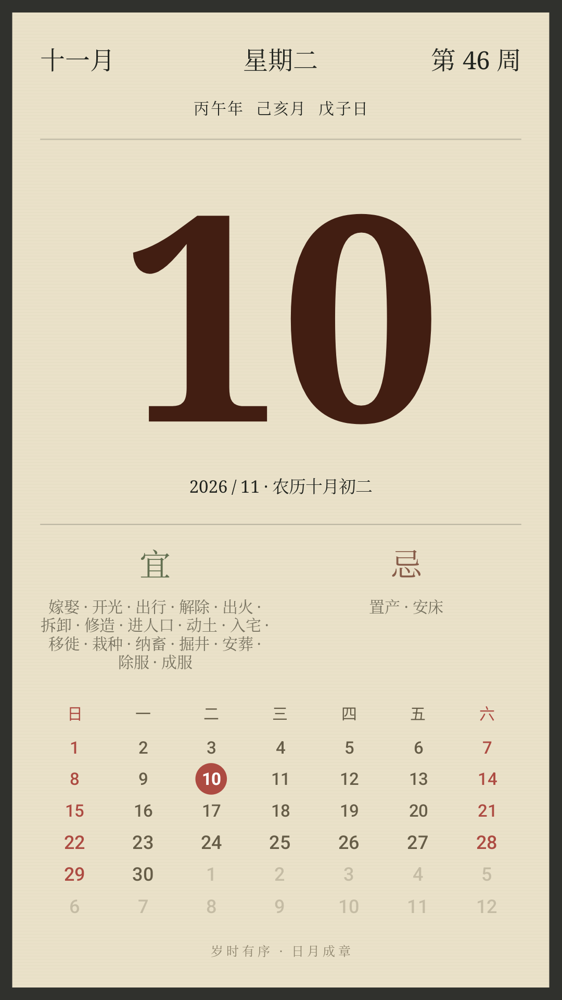 |  |

## 把喜欢的主题，收进自己的日历

`compat` 分支只提供十一个内置主题，不再包含主题商店；内置主题不可删除、不可调整顺序，始终按固定顺序全部可用。

推荐和收藏页点击“应用”即可安装，安装中显示圆形进度提示，完成后变为“已安装”，再次点击可以确认移除。在收藏页取消收藏后，卡片暂时保留，离开前再次点击心形即可撤销；切换标签或退出商店时保存。

删除会重置该主题的个人图片与样式，收藏仍然保留。重新添加的主题使用默认外观，排在列表最后。目前商店提供内置主题，无需联网。

## 让日历带上你的生活

“冬日来信”和“拾光”支持替换本机图片。可以放上旅行照片、喜欢的插画，或一张值得每天看见的合影。

- **三种图片填充方式**：等比填充、完整显示、拉伸填充，按画面选择合适的呈现方式。
- **每个主题独立保存**：照片与填充方式互不影响，切换回来仍是你的设置。
- **随时恢复默认**：想换回原来的样子，一次点击即可。

选取图片使用系统照片选择器，无需开放整个相册的访问权限。图片保存为应用内副本，离线也能显示。

开发者还可以为自定义主题[附带多款字体](docs/theme-fonts.md)并指定默认字体。使用这类主题时，样式设置会显示字体样张，可切换附带字体、跟随主题默认或恢复模板原字体；每套主题独立记住选择。

## 日期之外，也有每天的新内容

CalendarMods 会随设备日期与时区更新。前台全屏跨过午夜时，十一种主题会以各自的翻页、揭页或轻柔淡换迎接新的一天；从后台回来直接同步当前日期。

每个主题的样式设置都提供两个独立开关：

- **翻页动画**：默认开启，关闭后日期直接切换，手动翻页也不播放过渡。
- **交互式日历**：默认关闭。开启后，全屏左右滑动可浏览其他日期；“冬日来信”和“拾光”按月翻页，其余主题按天翻页。浏览其他日期时，点击底部“回到今天”即可恢复实时日期；长按返回主题选择。

两个开关按主题独立保存，横竖屏均可使用；调整它们不会改变照片、填充方式或字体设置。

- **公历与农历同看**：日期、星期、周序、农历和月历高亮随当天变化。
- **节气与节日提醒**：展示当天的节气、传统节日和公历节日，同一天的多个节日一并保留。
- **传统宜忌**：“好日”逐项呈现，“一页”成组轮播，“岁时”完整展示，融入各自的版式。
- **每日原创文句**：366 条短格言与“慢笺”专属的 366 个二字心语，每天轮换，跨年不重置。

日期、历法与每日文句均可离线使用，应用无需联网权限。传统宜忌作为民俗历法内容展示。

## 开始使用

1. **左右滑动**，找到喜欢的主题。
2. **点击主题名称右侧的样式按钮**，查看当前主题的个性化选项。
3. **单击日历**，进入沉浸全屏。
4. **长按界面或按返回键**，回到主题选择页。

## 下载体验

[](https://github.com/heyiWF/CalendarMods/actions/workflows/android.yml?query=branch%3Acompat)

前往 [安装包下载页面](https://github.com/heyiWF/CalendarMods/actions/workflows/android.yml)，选择一次成功的构建，在 **Artifacts** 中下载 `CalendarMods-debug-运行序号`，解压后安装 `CalendarMods-debug.apk`。

目前提供开发预览版 APK，支持 Android 4.0（API 14）及以上设备。

## 更多

- [反馈问题与建议](https://github.com/heyiWF/CalendarMods/issues)
- [主题扩展开发文档](docs/theme-contract.md)
- [素材与来源说明](docs/assets.md)
- [MIT 开源许可](LICENSE)

截图展示的是拍摄当天的内容，实际日历会随日期更新。

交互式日历开启后保持原有页面大小，左右滑动浏览日期。离开今天后，底部中央浮现“回到今天”按钮；返回今天后淡出，不预留底栏空间。

## 开发与文档

[中英文文档索引](docs/README.md) · [本次验收](docs/verification-2026-11-08.md)

```powershell
.\gradlew.bat --no-daemon testDebugUnitTest lintDebug assembleDebug assembleDebugAndroidTest
```

使用 Android Studio JBR 与本机 SDK。独立验收请在 PowerShell 中为属性参数加引号，例如 `'-Pcalendarmods.applicationId=com.calendarmods.audit'`，并安装匹配的应用／测试包。
