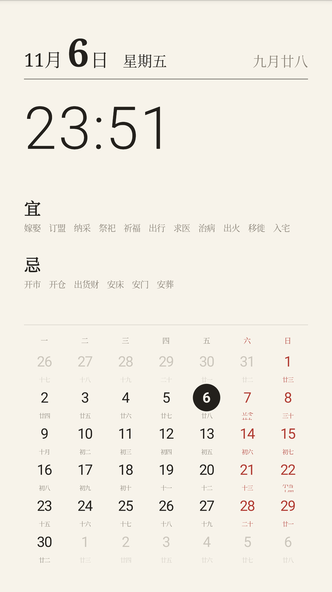
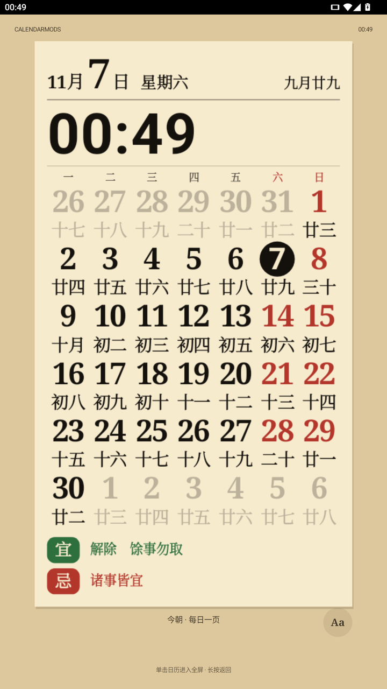
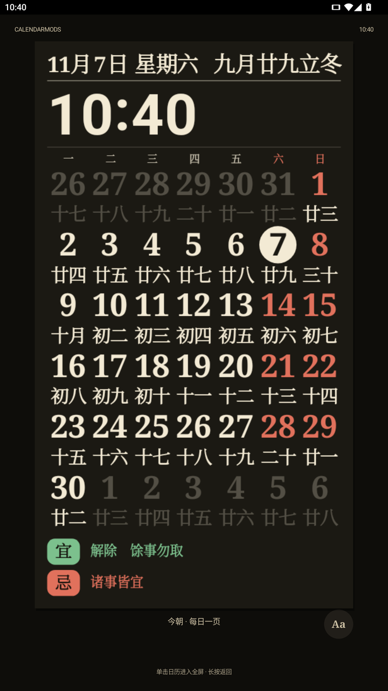

# CalendarMods

**把一页喜欢的日历，留在屏幕上。**

CalendarMods 是一款专注于日历展示的 Android 应用。整页只保留一种版式：**今朝 · 每日一页**——护眼的纸张黄背景、粗体大号的日期行、一只安静的时钟、当天的宜与忌，以及一张周一开头的月历。轻点进入全屏，让手机或平板成为一页随时间更新的日历。

**单一版式 · 六十格月历 · 农历与节气轮播 · 日期行节气连排 · 字号滑块 · 12/24 小时制 · 深浅两套纸 · 沉浸全屏 · 午夜翻页 · 离线使用**

支持 **Android 4.0（API 14）及以上**。界面由系统 View 与 Canvas 绘制，不依赖 Jetpack Compose，也不使用 `java.time` 或图片资源。

| 竖屏，一页完整的日历 | 横屏，通栏日期行与整块下移的月历 |
| --- | --- |
|  |  |
|  |  |

## 一页纸上的月历

月历固定为六行七列，**周一在前、周日在后**，所以每个月都是完整的六十格，月初落在周中也保持同一张版式。

- **每格两行**：上方是当天的日号，下方是当天的农历，都用粗体印出，尽量占满格子的可用高度。
- **周末红字**：周六、周日的日号用红色印出，一眼看得见休息日；农历保持纯黑，保持整齐。
- **今天实心圆**：今日的日号反白印在黑底实心圆上，翻到别的日期时圆点跟着移动。
- **非本月淡出**：月初月末补位的日期降到 26% 不透明度，保留上下文但不抢视线。

当某天有节气或节日时，下方那一行会在**农历、节气、节日之间轮播**：每项停留 **3 秒**，过渡时旧文字向上滑出、新文字自下而上滑入，整页所有格子共用同一条时间轴，所以一行里的日期同步翻页。清明节气的判定只落在节气当天，节日有多个名称时会依次轮播。

## 日期行与时钟

日期行写成一串“**11月 7 日 星期六 九月廿九立冬**”：月份、日号、“日”字、星期与右侧的农历**全部同一字号、同一字重、同一条基线**，整行像一块印好的铅字。右侧那一段直接把当天的节气或节日接在农历后面，中间不留空格；整行放不下时按比例一起缩小，间距同步收紧，农历始终留在原位。

- **节气与节日一气连排**：当天交节就接节气（`九月廿九立冬`），没有节气就接当天第一个节日（`八月十五中秋节`）；一段文字印到底，不轮播、不换行。
- **边距收到 14**，元素贴近屏幕边缘，省下来的空间全部给字号。
- **横屏通栏**：日期行与下方分隔线贯穿整个屏幕宽度，月历排在通栏线下方并贴住屏幕下沿，整体向下移动。
- 时钟使用粗体数字，竖屏 64 号，横屏按左列宽度自动放大；**冒号按字形墨迹抬到数字的垂直中线**，与数字齐平。
- **12 / 24 小时制**：默认 24 小时制（`01:05`）。关掉后读作 `上午9:05`、`下午12:30`——上午/下午与数字同字号，冒号同样居中，整行按列宽自动收缩，始终收在列宽之内。
- **宜、忌在左下角**：绿色圆角块里一个白色「宜」字，条目用绿色；红色圆角块里一个白色「忌」字，条目用红色。条目自动换行；某一侧条目为空时印“诸事不宜”或“诸事皆宜”。

## 轻点展开，专注于眼前这一页

单击日历，它会从预览平滑展开到全屏，隐藏状态栏与导航栏。长按或使用系统返回键，日历便缩回原来的位置。沉浸显示时屏幕保持常亮；返回预览后恢复正常熄屏。横竖屏都有对应版式：竖屏是一张完整的纸页，横屏左列是日期、时钟与宜忌，右列是月历。

## 样式设置

右上角的样式按钮提供一条字号滑块、一组深色模式与四个开关，修改即时生效并自动保存：

- **字号**：85% – 140% 连续可调，默认 100%。整页等比缩放，同时逐块校验：日期行与农历各有各的位置，月历格子保持固定的高宽比，宜忌块收在页面下方一角。拉到两端时整页依旧完整落在屏幕内，每一块都读得清。
- **24小时制**：默认开启。关闭后按 12 小时制显示，`上午9:05` / `下午12:30`，「上午 / 下午」与时间数字一样大。
- **深色模式**：默认关闭。可以选「始终深色」直接换成深色纸；也可以「定时切换」，在设定的夜间窗口内（默认 19:00 – 07:00，可跨午夜、可逐小时调整）自动换页；设备带光线传感器时还会出现「跟随环境光」，环境变暗时切深色、变亮时切回浅色。手动切换只换配色，文字与版式保持原位。
- **翻页动画**：默认开启，跨过午夜时以 3D 翻页迎接新的一天；关闭后日期直接切换。
- **人脸感应亮屏**：默认关闭，带摄像头的设备会显示这一项。开启并授权摄像头后，全屏时会根据画面判断有没有人在看，有人靠近自动点亮，离开一段时间后允许熄屏。画面只在内存中参与判断，应用完全离线运行。
- **交互式日历**：默认关闭。开启后可在全屏左右滑动浏览其他日期，离开今天时底部浮现“回到今天”。

## 开始使用

1. **点击样式按钮**，拖动字号滑块、切换 12/24 小时制、挑选深色模式，或按需打开翻页动画、人脸感应亮屏与交互式日历。
2. **单击日历**，进入沉浸全屏。
3. **长按界面或按返回键**，回到预览页。

| 预览页：点右下角 Aa 调整样式 | 深色模式下的预览页 |
| --- | --- |
|  |  |

日期、农历、节气与宜忌全部离线计算，随设备日期与时区更新；前台全屏跨过午夜会自动进入新的一天，从后台回来时直接同步。

节气、农历与传统节日取自 [tyme](https://github.com/6tail/tyme) 历法体系（应用内置 `cn.6tail:tyme4j:1.5.1`），只收主流节日——元旦、春节、元宵、清明、端午、七夕、中元、中秋、重阳、腊八、除夕，以及妇女节、劳动节、儿童节、教师节、国庆节等；数九与三伏这类季节性标记参与月历轮播。宜忌同源，作为民俗历法内容展示。

## 下载体验

前往 [安装包下载页面](https://github.com/heyiWF/CalendarMods/actions/workflows/android.yml)，选择一次成功的构建，在 **Artifacts** 中下载 `CalendarMods-debug-运行序号`，解压后安装 `CalendarMods-debug.apk`。

目前提供开发预览版 APK，支持 Android 4.0（API 14）及以上设备。

## 更多

- [反馈问题与建议](https://github.com/heyiWF/CalendarMods/issues)
- [页面版式与数据来源](docs/daily-page.md)
- [深色模式](docs/dark-mode.md)
- [设备验收](docs/device-validation.md)
- [Android 4.0 兼容说明](docs/compat-android-4.md)
- [素材与来源说明](docs/assets.md)
- [MIT 开源许可](LICENSE)

截图展示的是拍摄当天的内容，实际日历会随日期更新。宜忌作为民俗历法内容展示。
