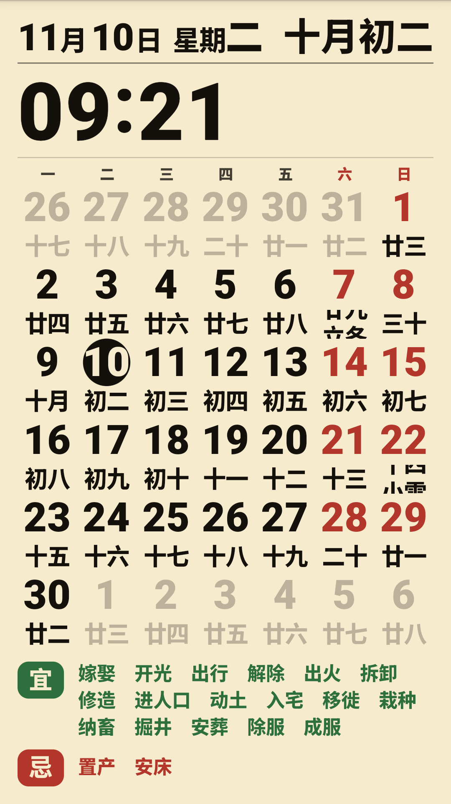
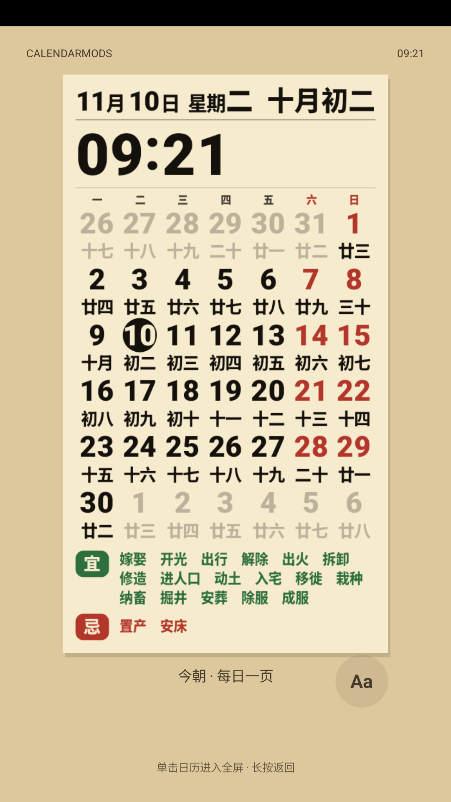
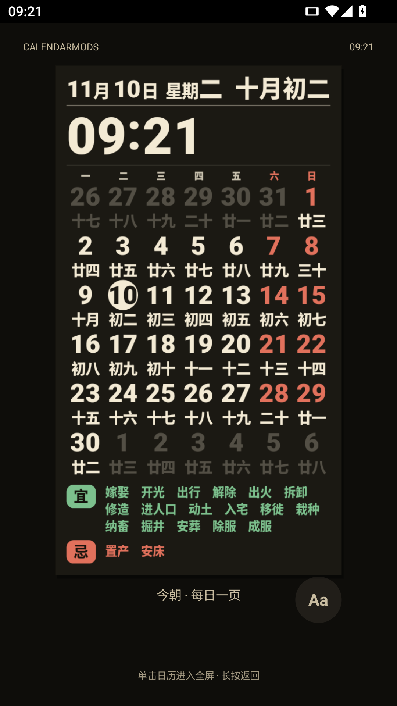

[中文](README.md) | [English](README.en.md)

# CalendarMods


**把一页喜欢的日历，留在屏幕上。**

CalendarMods 是一款专注于日历展示的 Android 应用。整页只保留一种版式：**今朝 · 每日一页**——护眼的纸张黄、醒目的大日期、一只安静的时钟、当天的宜与忌，以及一张周一开头的月历。轻点进入全屏，让手机或平板成为一页随时间更新的日历。

**单一版式 · 四十二格月历 · 农历与节气 · 每日宜忌 · 字号可调 · 深浅两套纸 · 沉浸全屏 · 午夜翻页 · 离线使用**

支持 **Android 4.0（API 14）及以上**。

截图更新于 **2026-11-10**，来自本分支最新构建。预览图保留右下角的样式设置按钮；全屏图单独展示。

| 竖屏，一页完整的日历 | 横屏，通栏日期行与整块下移的月历 |
| --- | --- |
|  |  |
|  |  |

## 一页纸，看完今天

打开就是今天——日期、农历、节气、节日连成一行，时钟与宜忌相伴，整张月历铺在下方。竖屏上下舒展，横屏左右展开，深浅两套纸随手切换。

- **今天一眼锁定**：大日期加上实心圆高亮，周末标红，哪天休息一目了然。
- **当月在握**：周一开头的月历，农历与节气、节日随日轮换，每天都有新内容。
- **宜忌各归其位**：绿「宜」红「忌」分列左下角，民俗历法内容每天不重样。

## 轻点展开，专注于眼前这一页

单击日历，它会从预览平滑展开到全屏，隐藏状态栏与导航栏，适合放在桌面或支架上随时查看。沉浸显示时屏幕保持常亮；长按或使用系统返回键，日历便缩回原来的位置，恢复正常熄屏。横竖屏都有对应的版式，旋转屏幕依然是一页完整的日历。

## 按自己的习惯调整

预览页右下角的 Aa 样式按钮集中了常用选项，修改即时生效并自动保存：

- **字号**：一条滑块调整整页大小，从紧凑到放大，整页都完整落在屏幕内。
- **12 / 24 小时制**：默认 24 小时制；切换后读作「上午9:05」「下午12:30」，上午／下午为数字半高，上午顶端对齐、下午底端对齐，空出的宽度让时间数字放大。
- **深色模式**：可以始终使用深色纸，也可以设定夜间时段自动切换；带光线传感器的设备还能跟随环境明暗。
- **翻页动画**：默认开启，跨过午夜时以翻页迎接新的一天；关闭后日期直接切换。
- **人脸感应亮屏**：带摄像头的设备可选，全屏时检测到人脸提高窗口亮度，离开一段时间后调暗，屏幕仍保持常亮。画面只在本机参与判断。
- **交互式日历**：开启后，全屏左右滑动就能浏览其他日期，底部「回到今天」一键回到实时日期。

| 预览页：点右下角 Aa 调整样式 | 深色模式下的预览页 |
| --- | --- |
|  |  |

## 日期之外，也有每天的新内容

CalendarMods 随设备日期与时区更新：前台全屏跨过午夜自动进入新的一天，从后台回来直接同步当前日期。日期、农历、节气、节日与宜忌全部在本地计算，离线也能照常使用。

节气、农历与传统节日取自 [tyme](https://github.com/6tail/tyme) 历法体系，只收主流节日——元旦、春节、元宵、清明、端午、七夕、中元、中秋、重阳、腊八、除夕，以及妇女节、劳动节、儿童节、教师节、国庆节等。宜忌同源，作为民俗历法内容展示。

## 开始使用

1. **点击样式按钮**，调整字号、12/24 小时制与深色模式，或按需打开翻页动画、人脸感应亮屏与交互式日历。
2. **单击日历**，进入沉浸全屏。
3. **长按界面或按返回键**，回到预览页。

## 下载体验

[](https://github.com/heyiWF/CalendarMods/actions/workflows/android.yml?query=branch%3Amycompat)

前往 [安装包下载页面](https://github.com/heyiWF/CalendarMods/actions/workflows/android.yml)，选择一次成功的构建，在 **Artifacts** 中下载 `CalendarMods-debug-运行序号`，解压后安装 `CalendarMods-debug.apk`。

目前提供开发预览版 APK，支持 Android 4.0（API 14）及以上设备。

## 更多

- [反馈问题与建议](https://github.com/heyiWF/CalendarMods/issues)
- [页面版式与数据来源](docs/daily-page.md)
- [深色模式](docs/dark-mode.md)
- [设备验收](docs/device-validation.md)
- [Android 4.0 兼容说明](docs/compat-android-4.md)
- [素材与来源说明](docs/assets.md)
- [MIT 开源许可](LICENSE)

截图展示的是拍摄当天的内容，实际日历会随日期更新。宜忌作为民俗历法内容展示。

日期行的“月”“日”“星期”缩小，数字和星期最后一字使用更高字重；周六、周日整段星期文字标红，不考虑节假日。

## 开发与文档

[中英文文档索引](docs/README.md) · [本次验收](docs/verification-2026-11-08.md)

```powershell
.\gradlew.bat --no-daemon testDebugUnitTest lintDebug assembleDebug assembleDebugAndroidTest
```

使用 Android Studio JBR 与本机 SDK。独立验收请在 PowerShell 中为属性参数加引号，例如 `'-Pcalendarmods.applicationId=com.calendarmods.audit'`，并安装匹配的应用／测试包。
