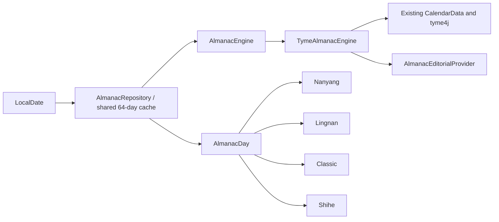

[中文](almanac-engine.md) | [English](almanac-engine.en.md)

# Reusable almanac data contract

The almanac is a host data capability, not a second calculation library bundled with a theme. Four renderers declare `ThemeDataCapability.ALMANAC` and read immutable `AlmanacDay` values from the shared repository. Renderers do not import tyme or create engines according to theme ID.

- `AlmanacEngine.calculate(date)` accepts no Android context, font, color or theme. The app retains one tyme4j dependency.
- `AlmanacDay` contains calendar, suitable/avoid, hours, directions, nine-palace and festival data. Editorial material is separate in `AlmanacEditorial`.
- `AlmanacProfile` identifies calendar, folk-rule and editorial versions. A version change creates a new engine/repository rather than mixing cached results.
- `AlmanacEditorialProvider` can replace source material without changing the renderer or calendar implementation.
- `AlmanacRepository` is a bounded synchronized LRU. Same-day preview, thumbnail and all four renderers share one calculation.
- `AlmanacHost`/`LocalAlmanacRepository` are Compose injection points; another host or tests can replace the service. The compat host uses framework date values and direct repository injection instead.
- `ThemeRenderer.dataCapabilities` declares requirements. External variants select a stable renderer ID and never carry calculation code.

Existing themes continue using `CalendarData`; the engine reuses its date, festival and suitable/avoid results. `AlmanacEngineTest` checks shared instances, eviction and editorial replacement.

Palette, scheduled night mode and ambient light affect presentation without invalidating calendar caches. Night scheduling uses actual device time, independently of a historical/future browsed date. Shihe illustration mapping consumes terms/festivals already computed by `CalendarData`/`AlmanacDay`, adding no second date algorithm.
