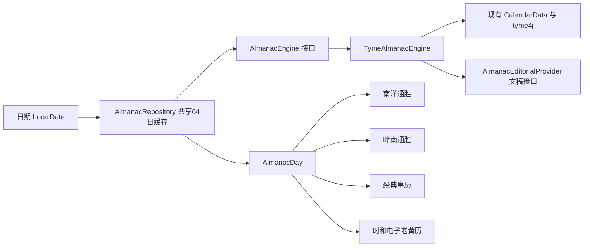

[中文](almanac-engine.md) | [English](almanac-engine.en.md)

# 可复用黄历数据契约

黄历是宿主的数据能力，不是主题附带的一套计算库。四款主题声明
`ThemeDataCapability.ALMANAC`，通过 `LocalAlmanacRepository` 读取只读的 `AlmanacDay`。
渲染器不引用 tyme，也不根据主题 ID 创建引擎。

- `AlmanacEngine.calculate(date)` 不接受 Android Context、字体、颜色或主题。只有原来的一份 tyme4j 依赖。
- `AlmanacDay` 包含历法、宜忌、时辰、方位、九宫、节庆等字段；编选内容放在独立的 `AlmanacEditorial`。
- `AlmanacProfile` 标识历法、民俗和文稿版本。切换版本创建新引擎/仓库，不混用缓存。
- `AlmanacEditorialProvider` 可独立更换资料与文稿，不改渲染器或历法实现。
- `AlmanacRepository` 是有界、同步的 LRU，同日的预览、缩略图和四款主题共用同一个计算结果。
- `AlmanacHost` 是 Compose 注入点，其他宿主或测试可以整体替换数据服务。
- `ThemeRenderer.dataCapabilities` 声明所需数据能力；外部主题仍以稳定的 renderer ID 接入，不携带计算代码。

原有 `CalendarData` 继续服务旧主题，新引擎复用其日期、节日与宜忌结果。
`AlmanacEngineTest` 验证四款共享实例、缓存淘汰和文稿替换。

配色、深色定时与光线只影响展示，不使历法缓存失效。定时依据设备当前时间，
与正在浏览的历史/未来日期无关。

时和主题的插画映射只消费 `CalendarData` / `AlmanacDay` 已算出的节气和节日，不添加第二套日期算法。
