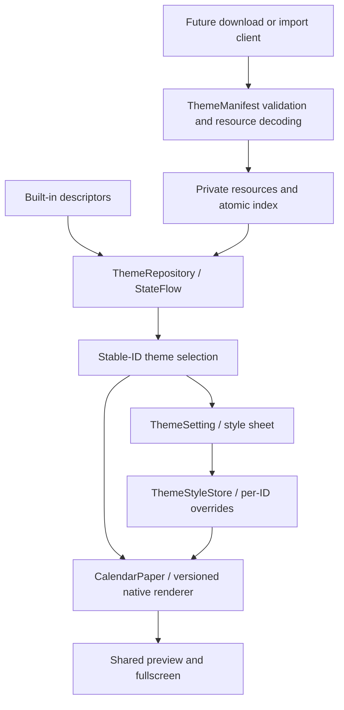

[中文](theme-contract.md) | [English](theme-contract.en.md)

> Branch scope: compat has no store/install/uninstall/reorder UI. This document preserves package-format and Compose-store reference material. Its actual host uses PageArtwork, framework Canvas and a fixed inventory to read existing data. Install/StateFlow examples apply to main/pro, not directly to compat.

# Theme design contract, schemas 1 and 2

Themes are versioned data; renderers are trusted capabilities supplied by the app. Built-in and installed themes share `CalendarTheme`, consumed by preview, fullscreen, settings and stable selection. The local theme store supports adding presets, favorites and ordering. Accounts, upload, moderation and network downloads are not implemented.

## Layers and entry points



`ThemeContract.kt` defines identity, versions, surfaces, settings and installation/selection rules without Android dependencies. `ThemeManifest.kt` provides strict JSON encoding/decoding for future packages and editors. `ThemeRepository.kt` owns inventory, install/upgrade/uninstall, private resources, atomic indexing and observable state. `ThemeStyle.kt` handles declared settings, overrides, migration, image selection and fallback. `ImmersiveCalendar.kt` is the Compose rendering dispatch point; downloaded themes cannot supply executable rendering code.

## Identity and lifecycle

| Field | Contract |
| --- | --- |
| `id` | Immutable namespace ID, e.g. `org.example.winter`; lowercase letters/digits, dots or hyphens; at most 120 characters; independent of title/order |
| `schemaVersion` | Integer 1 or 2; schema 2 adds fonts; schema 1 remains supported; unknown versions are rejected |
| `version` | Positive integer; updates to an ID must strictly increase it; equal versions and downgrades are rejected |
| `title`, `author` | Nonblank, at most 80 characters, no control characters; author is display metadata, not authentication |
| `renderer` | Exact host wire ID; updates cannot change renderer for the same theme ID |
| `surfaces` | Optional host colors and system-icon mode; missing values inherit the built-in renderer defaults |
| `defaults.fill` | Image-renderer fill default; forbidden without an image slot |
| `imageAsset` | Defaults to false; must match presence of installation image bytes |
| `fonts` | Schema 2 only; up to eight stable `{id, title}` entries, supplied as bytes keyed by ID |
| `defaults.font` | Schema 2 only; defaults to `template`, otherwise must name a declared font |

`com.calendarmods.*` is reserved for built-ins. External themes cannot overwrite it. Themes initially follow addition order, with explicit reordering supported. Upgrades retain position. Built-ins may be removed, but at least one installed theme must remain. At most 200 external themes are stored.

Selection uses `calendar.theme_id`. When no ID exists, the legacy `calendar.theme` ordinal migrates once using the original seven-theme order. Installing, removing an earlier theme or renaming a theme does not alter a surviving selected ID. Missing selection falls back to a usable installed theme. Pager keys, page counts and semantics use repository state; at most nine nearby indicators are shown.

## Native renderers and settings

| Built-in suffix | Renderer | Content | Renderer-specific options |
| --- | --- | --- | --- |
| `golden` | `golden.v1` | Yellow weekday bar, large date, lunar date; landscape month grid | None |
| `teddy` | `illustration.v1` | Illustration, lunar month grid, daily words | `image`, `fill` |
| `photo` | `photo.v1` | Photo, month grid, daily words | `image`, `fill` |
| `good-day` | `good-day.v1` | Serif date, festival, centered suitable-activity carousel | None |
| `verse` | `verse.v1` | Vertical words, month grid, daily phrase | None |
| `almanac` | `almanac.v1` | Vintage almanac, festivals, complete suitable/avoid lists, month grid | None |
| `hanging` | `hanging.v1` | Hanging binding, large date, paired almanac entries | None |
| `traditional` | `traditional.v1` | Nanyang tear-off almanac | Almanac appearance |
| `canton` | `canton.v1` | Lingnan almanac | Almanac appearance |
| `auspicious` | `auspicious.v1` | Classic almanac | Almanac appearance |
| `peitaiyi` | `peitaiyi.v1` | Shihe electronic almanac | Almanac appearance |

The four additional renderers declare `ALMANAC` and share the [host engine](almanac-engine.en.md), including ink, special editions and manual/scheduled/ambient dark controls.

All renderers also offer `page_animation` (true) and `interactive` (false) as host-owned `ThemeSetting.Toggle` values. They persist per stable ID, add no manifest fields and do not change schemas 1/2. Uninstall resets them. `ThemeRenderer.settings` declares renderer capabilities; `CalendarTheme.settings` adds font choices when a catalog exists. `ThemeSetting.Image` represents local selection; `Choice` represents a finite value set. UI looks up property keys, not hardcoded theme IDs. A theme cannot declare an option the renderer does not consume.

Interactive mode applies only to fullscreen. Illustration/photo themes page by month; others page by day. Month paging retains the preferred day and clamps short months. Browsing survives rotation, resets on fullscreen exit and follows the clock again after returning to today. Disabling page animation affects automatic midnight and manual paging while keeping swipe navigation available.

| Property | Type/default | Consumer and constraints |
| --- | --- | --- |
| `image` | Nullable private user-image path | Locally generated, never published in a manifest; user image overrides package image, then built-in fallback |
| `fill` | Enum, author default `crop` | `crop` proportional cover, `fit` complete image, `stretch`; shared by all previews/fullscreen |
| `surfaces.backdrop` | `#AARRGGBB` | Chooser background |
| `surfaces.paper` | `#AARRGGBB` | Outermost fullscreen paper; inner photo/vintage surfaces remain renderer-owned |
| `surfaces.chrome` | `#AARRGGBB` | Chooser title, count, indicators and hints |
| `surfaces.darkSystemBarIcons` | Boolean | Dark chooser system icons; host hides system bars in fullscreen |

Colors are author defaults; there is no general user color editor. Schema 2 supports bundled fonts: see [font guide](theme-fonts.en.md). Binding, decorations, detailed layout and carousel timing remain native renderer behavior; arbitrary fields are rejected.

Overrides are isolated by theme ID, including two themes sharing a renderer. Legacy `TEDDY.image/fill` and `PHOTO.image/fill` migrate once. Reset removes the relevant override while retaining migration markers so old values do not reappear. Changing a font does not freeze an inherited fill default. Upgrades preserve supported overrides and adopt new defaults for unoverridden properties. Local-library removal resets personal settings; re-add uses defaults. Repository initialization cleans unreferenced image/font files.

## Rendering contract

The host supplies `CalendarData` with local date, Gregorian/lunar labels, festivals, suitable/avoid lists, 42 cells and daily words, plus safe insets, window size and common carousel state. Themes cannot replace the clock or issue their own data requests.

New renderers must share `CalendarPaper` between preview/fullscreen, provide portrait/landscape under `FullPaper` scaling, and leave entry/exit, long press, gesture arbitration and system bars to the host. Each option needs declaration, default, bounded valid values, persistence and actual rendering consumption. Published wire IDs are permanent: incompatible behavior requires `.v2`, retaining the old renderer or an explicit migration. Preserve date semantics and test tags, and verify dynamic content, settings isolation and preview parity.

Register a permanent wire ID and supported properties in `ThemeRenderer`, then add a default descriptor and native dispatch implementation. Only new built-ins join `CalendarTheme.entries`; downloaded variants use repository installation. A new property kind must extend `ThemeSetting`, `ThemeStyle`, codecs, controls and acceptance together.

## Installing a package

See [schema 1 image example](theme-example.json) and [schema 2 font example](theme-font-example.json).

```kotlin
// Suspend API: validation, decoding and persistence run on IO inside the repository.
val repository = ThemeRepository.get(context)
val installed = repository.install(manifestJson, imageBytes) // Only for imageAsset=true.
repository.uninstall(installed.id)
```

Images supported by Android `ImageDecoder` are re-encoded to static PNG. Limits: 8 MiB compressed input, 64 million source pixels, 2048 px decoded longest edge, 32 KiB UTF-8 manifest. Unknown fields/types/renderers, incompatible schemas and invalid settings fail without publishing a new inventory.

StateFlow publishes only after `AtomicFile` commits. Updates use new immutable private image files to avoid partially replacing a displayed image. Random filenames are generated by the host. Manifests accept no paths, URLs, scripts, Dex, HTML or remote fonts. Index read errors or incompatible entries retain usable built-ins and expose `ThemeInventory.loadErrors`; further writes are blocked to avoid losing temporarily unreadable work. A future store needs explicit repair/redownload UX.

There is currently no import button, ZIP format or network service. This API is the local installation boundary for a future client; repository subscribers already update existing pages.

## Future authoring/store stages

1. Template-based editing: produce manifest/resources from host capabilities and preview through the same renderer. Server-side identity and theme-ID ownership must authenticate updates; `author` text cannot do so.
2. Publishing/downloading: define packages, hashes/signatures, licensing, moderation/reporting, search, progress/cancel and updates. Enforce transport limits before reading bytes, then call the installation API.
3. Free layout editing: add a constrained declarative renderer and separate schema for text/image/date/grid components, bindings, layout limits and font/motion budgets. Keep stable IDs and the repository lifecycle; do not load remote Kotlin/JS.

Schema 1 can distribute image/color variants of existing templates; arbitrary layouts require the third stage.

## Validation and historical results

```powershell
.\gradlew.bat --no-daemon testDebugUnitTest lintDebug assembleDebug assembleDebugAndroidTest
adb shell am instrument -w -e contract true com.calendarmods.test/com.calendarmods.CalendarAcceptanceInstrumentation
adb shell am instrument -w com.calendarmods.test/com.calendarmods.CalendarAcceptanceInstrumentation
```

Unit tests cover identity, legacy migration, versions, namespaces and invalid settings. Device checks cover real JSON codecs, invalid packages, image installation, live pages, default/override isolation, upgrades/removal/reload/rotation. Test themes are removed and original selection/settings restored.

On 2026-10-13, both APKs, 19 JVM tests and Lint passed. Android 15 full regression passed 54 checks; contract acceptance passed four scenario groups. A test theme appeared on page nine, retained its ID after an earlier theme was removed and moved to page eight; title/image remained correct after a landscape upgrade. A test timing issue was fixed by requiring option coordinates to remain stable for 500 ms before tapping. Ignored evidence: `docs/verification/logs/theme-contract-final-build.log`, `theme-contract-test-build.log`, `theme-contract-device-final.log`, `theme-contract-regression.log`, and `docs/verification/theme-contract/`.

## Local library index v2

Package schemas and private-index versions are independent. `themes-v1/index.json` is a v2 object containing `packages` (descriptors/image/font maps), `order`, `addedAt`, `favorites`, and `resetStyles`. Legacy arrays migrate once, with the original seven presets before existing external packages; failure preserves the original and blocks writes. Older package entries need no font map.

`catalog` is the available directory; `themes` is installed order. `add(id)` is idempotent. `uninstall`, `toggleFavorite`, atomic `setFavorites(Map<String, Boolean>)`, and `reorder` (complete, unique installed-ID permutation) serialize mutations and publish only after commit. Removal retains catalog resources and favorites but resets personal style; re-add appends. Removed external resources can be re-added without a version bump; imported upgrades still require a higher version.

Reset markers persist with installation state and replay after a crash. Removing the selected item chooses a successor or predecessor; ordering does not change selection. The store entry is not a theme ID.

## Midnight, previews and interactions

Every renderer maps to a `DayMotion`; variants inherit it without manifest changes. Only a natural midnight during continuous foreground fullscreen animates. Initial load, resume and clock/timezone adjustment refresh directly. Two GPU display lists preserve complete old/new pages and carousel state, keeping artwork/binding stable. Exit, rotation, backgrounding or disabled system animation ends the transition on the latest date.

Store cards place title above buttons, both centered. Recommended/favorite tabs use Apply/Installed; Installed offers Use/edit. Removal paths share confirmation and last-theme protection. Unfavoriting changes the heart immediately but retains the card; saveable pending IDs commit atomically only on tab change or leaving the store. Rotation, background and dialogs do not commit. Failure restores the displayed favorite state and reports the problem.

Visible static previews share a 32 MiB LRU across three tabs. Identity includes contract/version, date, style, image revision, orientation, target pixels, density and font scale. Generation is serialized, offscreen work cancels, and uncached generation pauses during entry/drag/scroll. Images decode on IO at target size; temporary images/live trees release after capture. Favorite/order/install-state changes do not invalidate identical previews. Host carousel pauses while the store is open.

Tabs fade out before fading/sliding in, retaining one stable-ID grid; incoming layout completes before fade-in. Pixel-rounding differences of 1–2 px between columns reuse thumbnails. Pausing does not erase an already-started capture.

`onAdd(id, reportProgress)` is suspending: use `null` for preparation/installation and `0..1` only for real byte progress. Material 3 `CircularWavyProgressIndicator` supplies indeterminate/determinate states (`material3:1.5.0-beta01`). Local presets do not fake download percentages. Pending operations reject duplicate input; success shows Installed, failure restores Apply and feedback.

Entering the store resets to Recommended; rotation preserves the tab and each tab's scroll position. Use has a store fade/target-preview slide, while Back collapses through the entry container. Done waits for `SheetState.hide()` before removing the sheet. Vertical delete locks the pointer sequence after touch slop, suppressing horizontal paging until release/cancel. The trash target scales around a fixed center.

Device modes include `-e store true`, `-e storeMotion true`, `-e performance true` (7/70/200 in-memory themes and FrameMetrics/PSS/cache), and `-e midnight true` (orientation/year/leap-day/interruption/disabled-animation cases). Test catalogs do not enter the user library. See [store validation](theme-store-validation.en.md) for measured limits and evidence.
