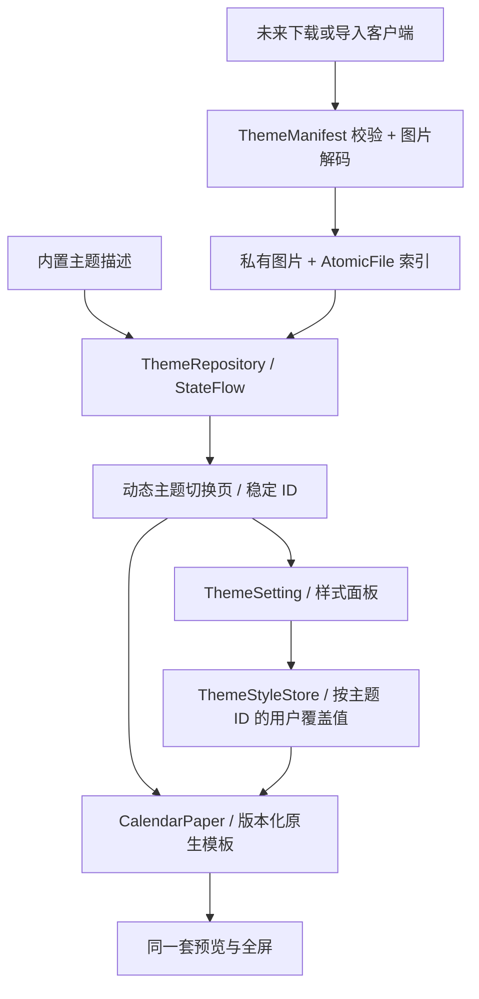

# 主题设计契约 v1

主题是可版本化的数据；模板是 App 提供的可信渲染能力。内置主题和安装主题共用 `CalendarTheme`，预览、全屏、设置和选择持久化均消费同一份描述。主题商店、账号、上传、审核和网络下载尚未实现。

## 分层与入口



- `ThemeContract.kt`：主题身份、版本、表面颜色、模板支持的设置及安装/选择规则；不依赖 Android。
- `ThemeManifest.kt`：严格 JSON 编解码，作为未来包格式和主题编辑器的共同入口。
- `ThemeRepository.kt`：内置与已安装主题清单、安装/升级/卸载、图片私有副本、原子索引及可观察列表。
- `ThemeStyle.kt`：由契约声明的设置入口、用户覆盖值、旧数据迁移、图片选择与回退。
- `ImmersiveCalendar.kt`：唯一模板分发点。绘制仍由 App 内的 Compose 代码负责。

## 身份、版本与生命周期

| 字段 | 契约 |
| --- | --- |
| `id` | 不变的命名空间 ID，例如 `org.example.winter`。小写字母/数字、点或连字符，最长 120 字符；与标题、排序无关 |
| `schemaVersion` | 描述格式版本，目前只接受整数 `1`。未知版本拒绝安装 |
| `version` | 同一 ID 的正整数版本，更新必须严格递增，禁止回退和重复安装 |
| `title` / `author` | 非空、最长 80 字符、无控制字符；作者字段是展示信息，不是身份认证 |
| `renderer` | 精确匹配宿主模板 wire ID；同一主题 ID 更新不能改变模板，防止设置语义错配 |
| `surfaces` | 可选的宿主表面颜色和系统栏图标模式，缺项继承对应内置模板 |
| `defaults.fill` | 图片模板的默认填充方式；无图片槽的模板禁止声明 |
| `imageAsset` | 是否提供主题默认图片，默认 false；必须与安装参数的图片存在性一致 |

`com.calendarmods.*` 保留给内置主题，外部安装不能覆盖。安装顺序稳定，升级替换原位置，内置主题不能卸载。最多安装 200 个外部主题。

主题选择保存为 `calendar.theme_id`。仅首次无 ID 时，把旧 `calendar.theme` 序号按原七主题顺序迁移。安装新主题、移除前面的主题或更新标题不会改变选中的 ID；选中主题不存在时回退到第一个内置主题。页面总数、语义描述和 Pager key 均来自仓库；底部最多显示九个邻近指示点。

## 七套原生模板与设置

| 内置 ID 后缀 | renderer | 布局内容 | 可调整属性 |
| --- | --- | --- | --- |
| `golden` | `golden.v1` | 黄色星期条、大日期、农历；横屏增加月历 | 无 |
| `teddy` | `illustration.v1` | 插画、农历月历与每日短句 | `image`、`fill` |
| `photo` | `photo.v1` | 照片、月历与每日短句 | `image`、`fill` |
| `good-day` | `good-day.v1` | 衬线大日期、节日、居中宜事项轮播 | 无 |
| `verse` | `verse.v1` | 竖排文句、月历、每日心语 | 无 |
| `almanac` | `almanac.v1` | 复古黄历、节日、完整宜忌、月历 | 无 |
| `hanging` | `hanging.v1` | 悬挂装订、大日期、双项宜忌轮播 | 无 |

`ThemeRenderer.settings` 是能力事实来源。`ThemeSetting.Image` 声明本机图片选择，`ThemeSetting.Choice` 声明有限选项；设置面板不再通过主题 ID 判断是否展示图片属性。v1 不允许远端主题自称支持渲染器没有消费的属性。

| 属性 | 类型 / 默认 | 约束与消费方 |
| --- | --- | --- |
| `image` | 用户私有图片路径，可空 | 路径只在本机生成，永不写入可发布 manifest；优先于主题包图片，再回退模板内置图片 |
| `fill` | 枚举，主题默认 `crop` | `crop` 等比填充、`fit` 完整显示、`stretch` 拉伸；预览、全屏与设置预览共同消费 |
| `surfaces.backdrop` | `#AARRGGBB` | 主题选择页背景 |
| `surfaces.paper` | `#AARRGGBB` | 全屏纸张最外层背景；照片框内和复古黄历内页仍由模板定义 |
| `surfaces.chrome` | `#AARRGGBB` | 选择页标题、计数、指示点和提示文字 |
| `surfaces.darkSystemBarIcons` | Boolean | 选择页系统栏使用深色图标；全屏时由宿主隐藏系统栏 |

颜色属于作者设计默认值，目前不生成用户调色面板。字体、装订、内页装饰、具体排版、时间与宜忌轮播参数仍是原生模板的一部分，不能在 v1 manifest 中随意添加字段。

用户设置按 ID 隔离；同模板的两个主题也互不影响。旧 `TEDDY.image/fill` 和 `PHOTO.image/fill` 一次性迁移到 ID 命名空间。恢复默认会删除覆盖值并保留迁移标记，防止旧值再次出现。主题升级保留已保存的覆盖值；未保存设置的主题采用新默认值。卸载保留个人设置，便于重装恢复；主题资源在下次仓库初始化时清理不再引用的图片。

## 渲染契约

宿主提供统一 `CalendarData`（设备当地日期、公历、农历、节日、宜忌、42 格月历和每日文句）、安全区、窗口尺寸和公共轮播状态。主题不能自行替换时钟或执行数据请求。

新增模板必须遵守：

1. 预览和全屏共同调用 `CalendarPaper`，禁止维护两份布局。
2. 同一模板有纵向与横向布局，沿用 `FullPaper` 的等比缩放与安全区处理。
3. 主题绘制不接管进入/退出、长按、滑动屏蔽或系统栏行为；这些由宿主统一负责。
4. 每个可调整属性必须同时具有声明、默认值、有限有效值、持久化和实际渲染消费方。
5. 模板 wire ID 一经发布不可改名。未来不兼容改动增加 `.v2`，保留旧渲染器或提供显式迁移，不能静默改变已下载作品。
6. 保持现有日期语义和测试标签；新增模板需验证横竖屏、动态内容、设置隔离以及预览/全屏一致性。

接入一个新的原生主题时，先在 `ThemeRenderer` 注册永久 wire ID 和支持的属性，再添加 `CalendarTheme` 默认描述与 `CalendarPaper` 的渲染实现。只有新的内置主题需要加入 `CalendarTheme.entries`；下载的模板变体只走仓库安装接口。新增属性种类时，同步扩展 `ThemeSetting`、`ThemeStyle`、编解码与设置控件，并为实际渲染行为补充验收，不能只加一个面板开关。

## 可安装示例与接入方式

完整示例见 [`theme-example.json`](theme-example.json)，复用插画模板。导入客户端在拿到内容后调用：

```kotlin
// suspend API；仓库内部在 IO 调度器完成校验、解码和持久化。
val repository = ThemeRepository.get(context)
val installed = repository.install(manifestJson, imageBytes) // imageAsset=true 才提供图片
repository.uninstall(installed.id)
```

`imageBytes` 支持 Android ImageDecoder 可解码的图片，导入后重编码为 PNG 静态图片。压缩输入最多 8 MiB，原始图片最多 6400 万像素，解码后长边最多 2048 像素。manifest UTF-8 最多 32 KiB；未知字段、错误类型、未知模板、不兼容 schema 或非法属性直接报错，失败不发布新清单。

索引通过 `AtomicFile` 提交后才发布 StateFlow；更新使用新的不可变图片文件，避免正在显示的旧版本读到半张图片。每个主题使用随机图片文件名，manifest 不接受文件路径、URL、脚本、Dex、HTML 或远端字体。索引读失败或单项不兼容时保留可用的内置主题，并在 `ThemeInventory.loadErrors` 提供诊断；此时阻止继续改写索引，避免一次安装把暂时无法读取的作品覆盖丢失。后续商店管理页需要提供对应的修复/重新下载操作。

这里的 API 是后续下载服务的本机安装边界，当前没有导入按钮、ZIP 格式或网络服务。页面已订阅仓库，因此接入下载完成回调后不需要另写一套主题页面。

## 主题商店后续阶段

1. **模板式创作**：编辑器从宿主模板和受支持属性生成 manifest + 图片，提供同一渲染器预览。服务器分配/验证作者身份与主题 ID 所有权；客户端不能靠 `author` 字符串判定更新可信。
2. **发布与下载**：补充包格式、哈希/签名、许可证及素材授权、审核举报、列表搜索、下载进度/取消、更新策略。传输端在读取字节前执行大小限制，下载完成后再调用已有安装 API。
3. **自由布局创作**：新增受约束的声明式布局渲染器和独立 schema，定义文本/图片/日期/月历组件、数据绑定、布局边界、字体与动效预算。保持主题 ID、仓库、安装生命周期和选择机制；不要把远端 Kotlin/JS 当作主题加载。

v1 可以发布现有模板的图片与表面配色变体；完全自由的新布局需要第三阶段。这样先开放作者创作，同时保留以后拓展的路径。

## 验证入口

```powershell
.\gradlew.bat --no-daemon testDebugUnitTest lintDebug assembleDebug assembleDebugAndroidTest
adb shell am instrument -w -e contract true com.calendarmods.test/com.calendarmods.CalendarAcceptanceInstrumentation
adb shell am instrument -w com.calendarmods.test/com.calendarmods.CalendarAcceptanceInstrumentation
```

契约单测覆盖稳定身份、旧选择迁移、版本规则、命名空间和非法属性。设备契约验收覆盖 JSON 真实编解码、错误包、图片安装、动态页面、默认值与设置隔离、升级/移除/重载/旋转。测试主题在结束时卸载，个人设置与原选中主题恢复。

### 2026-10-13 本地验收

- 最终应用与测试 APK 构建通过，19 项 JVM 测试通过，Lint 无问题。
- Android 15 / `emulator-5554`：七主题完整回归 `PASS 54 checks`，包含横竖屏、进出全屏及中途返回、午夜、时区和后台恢复。
- 动态主题契约 `PASS 4 checks`（四组场景）：错误包拒绝、旧设置迁移、带图片主题的即时安装及独立设置、更新/重载/旋转/卸载回退。
- 实际截图确认测试主题出现在第 9 页，移除前面的测试主题后保留选中 ID 并变成第 8 页；横屏更新后标题和图片保持正确。
- 重复验收曾暴露测试在底部面板动画中点击的问题，已改为等待选项坐标稳定 500 ms 后操作；最终复测通过。
- 本地日志：`theme-contract-final-build.log`、`theme-contract-test-build.log`、`theme-contract-device-final.log`、`theme-contract-regression.log`；截图位于 `docs/verification/theme-contract/`，均为忽略的本地验收产物。
