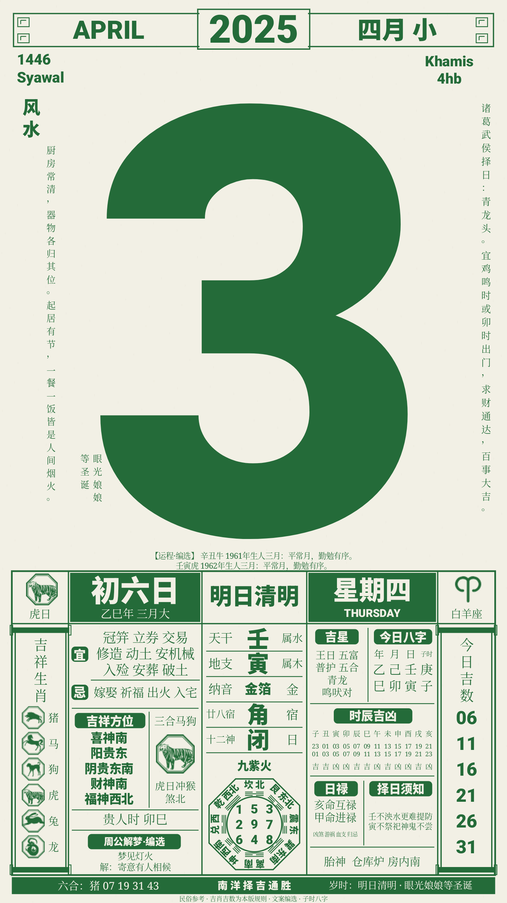
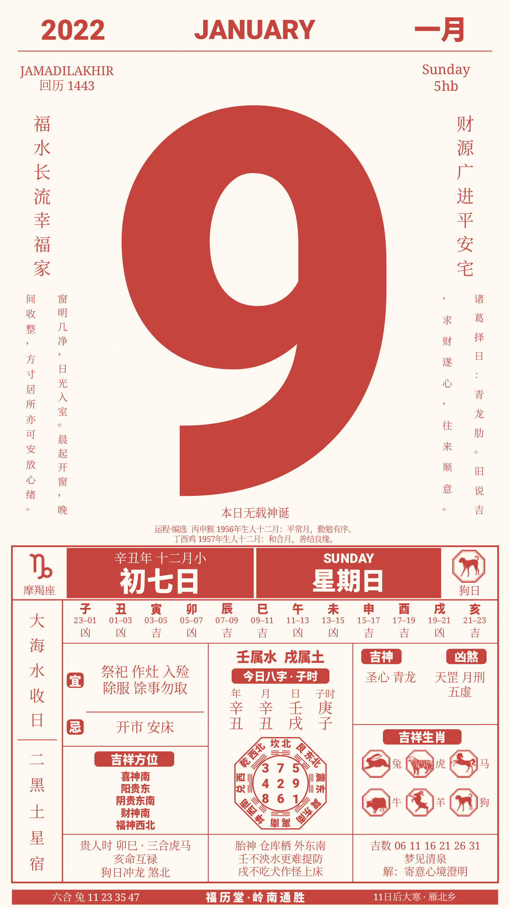
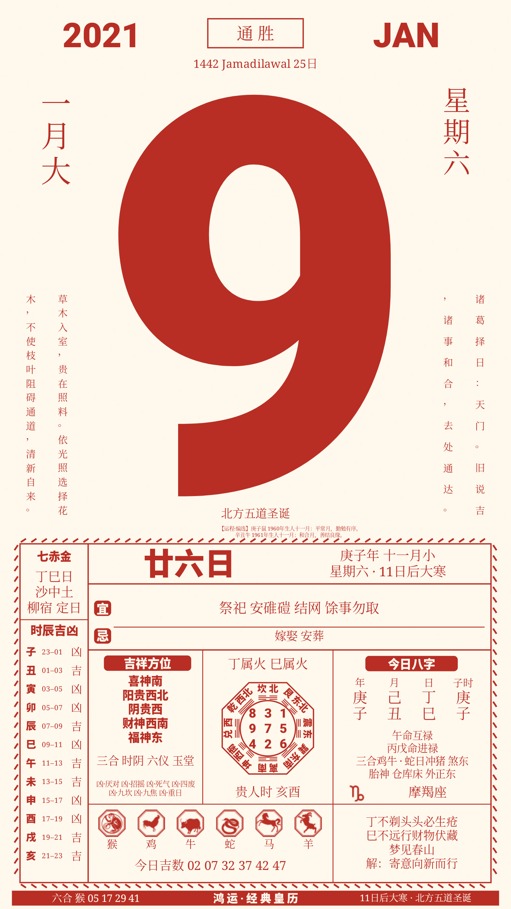
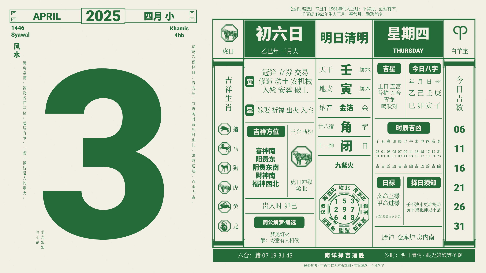
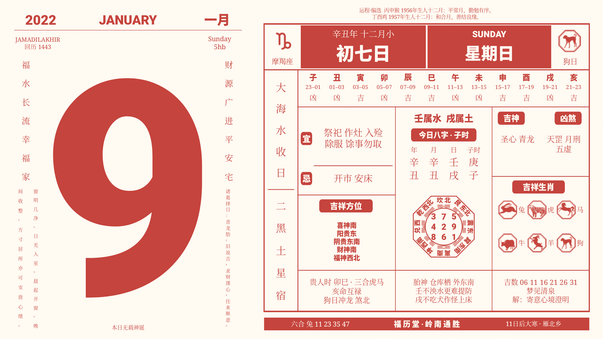
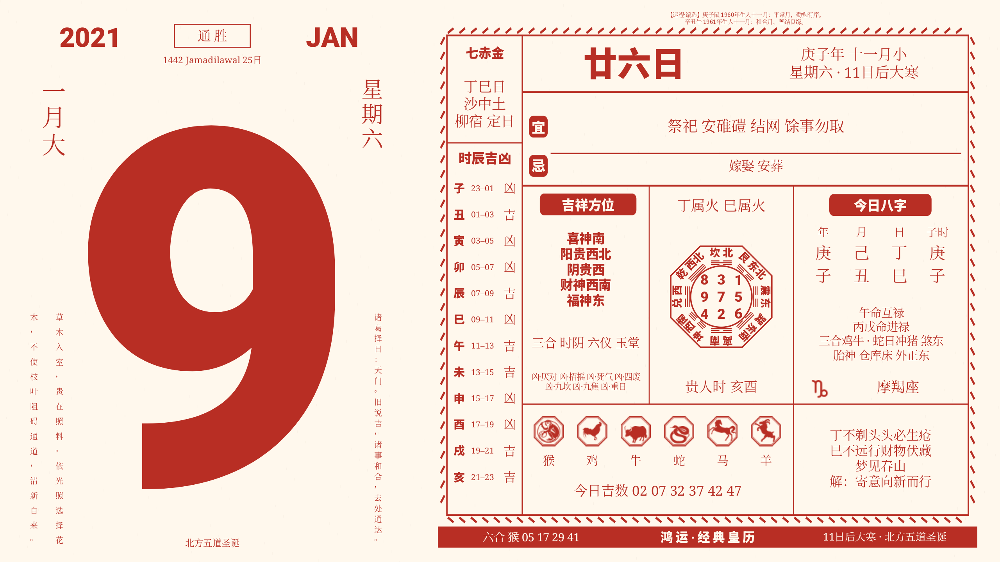
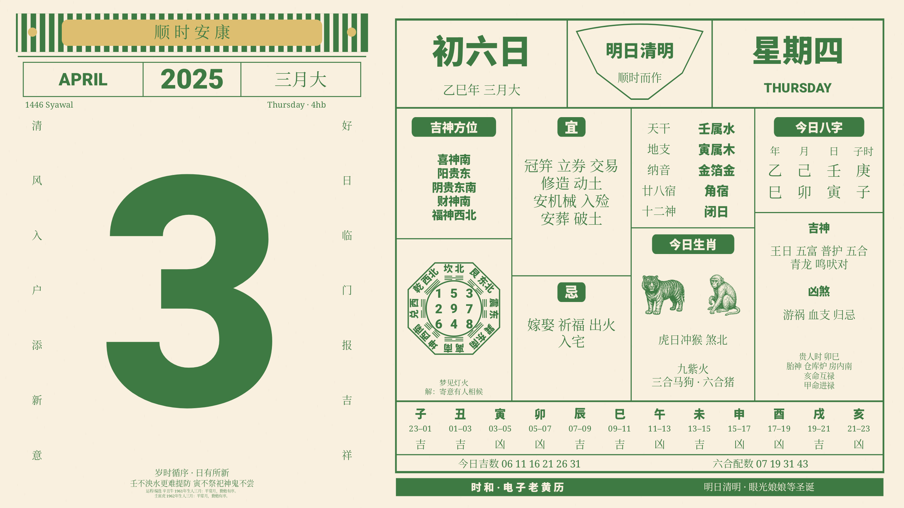
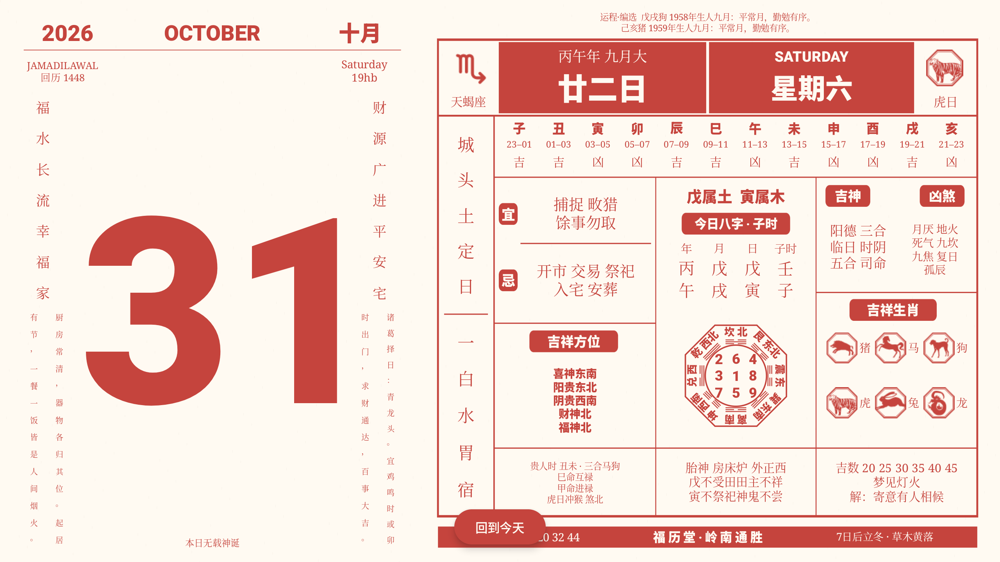

# 四款老黄历主题（pro）

从 `main` 的 `fa0b413` 创建 `pro`，追加四款内置主题（原有七款顺序不变）。首款永久主题 ID 为
`com.calendarmods.traditional`，渲染器 ID 为 `traditional.v1`；原有七款主题的 ID 和序号不变。
新安装默认包含十一款；已有主题库可从商店添加“南洋 · 手撕通胜”、“福历 · 岭南通胜”、“鸿运 · 经典皇历”、“时和 · 电子老黄历”。

## 版式与交互

以用户提供的 2025-04-03 绿色手撕通胜为版式参考：米白纸张、回纹月头、超大不补零日期、
中英马来语日期、两侧直排小字、运程横栏、左右卷轴、密集黄历分栏和九宫八卦。
全部使用 Compose Canvas 和 Android 字形度量绘制，不把照片当背景，也不包含照片水印。
字体走现有主题字体解析器，缩略图、预览和全屏共用绘制。
竖屏保持原图的上下关系；横屏改为日期在左、黄历在右，文字保持等比缩放。
所有宜忌/神煞条目都参与排版和无障碍描述，不截断数据。
继承每日翻页、午夜揭页、回到今天和长按退出，以及原有每主题交互开关。

## 数据与规则

四款通过共享的 `AlmanacRepository → AlmanacEngine → AlmanacDay` 取得同日数据，见[引擎契约](almanac-engine.md)。
绘制端按日期 remember，原有日历缓存照常生效。完全离线，不新增网络依赖。

| 栏目 | 来源与口径 |
| --- | --- |
| 公历、英文/中文星期、大小月 | java.time；31 日为大月，其余为小月 |
| 农历、干支、五行、纳音、胎神、二十八宿、建除 | 现有 tyme4j 1.5.1，采用 LunarDay 口径 |
| 宜忌、吉星、凶煞 | 与原 CalendarData 一致；不混拼 cnlunar 裁决 |
| 节气提示 | 搜寻未来 16 日内下一节气起始日；当日/明日/后日/若干日后 |
| 回历、马来语月份与星期 | tyme4j 计算回历＋本地马来语标签；没有声称是马来西亚官方观月历 |
| 今日八字 | 所选公历日期 00:00，明确标“子时”；不是个人出生八字 |
| 十二时辰 | 子时以当日 00:00 计算，随后取 02:00 到 22:00，黄黑道吉凶来自 tyme4j |
| 方位、三合、六合、冲煞 | tyme4j HeavenlyStem/EarthBranch API；阴贵阳贵分别显示 |
| 贵人时 | 天乙通行版：甲戊庚丑未、乙己子申、丙丁亥酉、辛寅午、壬癸卯巳 |
| 日禄 | 十干禄位表；日干禄支为互禄，禄在日支的天干为进禄 |
| 九宫 | tyme4j 日九星入中，洛书飞布；画面北上、东右，旋转南上洛书数组 |
| 六合生肖配数 | 1..49，以当年生肖为 1，逆序每 12 个循环；默认春节换年，可注入立春口径 |
| 吉祥生肖六个 | 本版规则：六合、三合优先，再同五行、顺序补足；去重并排除冲害；不是原版排名 |
| 今日吉数六个 | 本版装饰规则：日干五行对应河图尾数，按日期循环取六个；不声称预测结果 |
| 诸葛武侯择日 | `qimen-vol19-diagrams-v1`，见下文版本说明 |
| 民俗诞期 | nihaixia-app《玉匣记》固定月日资料；闰月不重复；无条目显示“本日无载神诞” |
| 运程 | 两个出生年份的生肖与流月关系＋自编中性文案，栏目注明编选 |
| 风水、周公解梦 | 原创短文和象征释义，按 epoch day 确定性轮播；不是原纸历逐日录文 |
| 底栏岁时摘要 | 节气提示＋当日节日；无节日时依次用神诞或物候填充。按用户要求删除潮水栏 |

### 诸葛择日版本

[《奇门遁甲秘笈大全》卷十九出行图转录](https://www.diancangwang.cn/xuanxuewushu/ddd428e2df4d/cdfb37c8d73f.html)
列明孟月初一堂房起、仲月初一天盗起、季月初一朱雀起。按图形顺逆顺序实现：

- 孟月（1/4/7/10）：堂房、金库、金堂、顺阳、贼盗、宝仓，6 日循环。
- 仲月（2/5/8/11）：天盗、天门、天堂、天财、天贼、天阳、天侯、天仓，8 日循环。
- 季月（3/6/9/12）：朱雀、白虎头、白虎肋、白虎足、玄武、青龙头、青龙肋、青龙足，8 日循环。

转录的图后摘要有漏项，使用图的位置和箭头，不直接采用漏项列表。
闰月采用同名月份组。三月初六算得青龙头，不对某个公历日期作特判。
断语由古籍内容简写；“白虎头”的吉凶在图版与[《玉匣记》](https://zh.wikisource.org/wiki/玉匣記)中不同，正文显式说明。
目前只有一张纸历样本，不能由一条匹配推断全年与出版社完全一致。

### 来源、许可与差异

- [tyme4j 文档](https://6tail.cn/tyme.html)，复用既有 1.5.1 Java 依赖，不再并列引入同源 Kotlin 引擎。
- [神诞原始资料](https://github.com/jangviktor-web/nihaixia-app/blob/master/lib/data/yuxiaji_deity_data.dart)，
  Dart 到 Kotlin 结构转换；上游 Apache-2.0 许可与改动说明随 APK 放在 `assets/notices/nihaixia-app.txt`。
- [《易图丹镜》天乙贵人](https://www.shidianguji.com/book/SDZJ0171/chapter/1kcbsgt5kd7oa)用于通行版贵人表。
- 未复制秦天监非商业项目的代码，未打包来源不清的解梦 SQL 或潮汐模型。
- 参考照片的贵人时、九星/九宫、宜忌和吉数可能与当前口径不同；不为了截图一致而覆盖计算值。

## 样式与夜间

四款独立保存原版、松绿、朱红、靛蓝、赭棕、黛紫、墨黑七种字体配色选项。
深色使用同色系浅色文字、深色纸面和外部背景。

- 手动深色保持开启；关闭后由自动选项决定。
- 定时默认 22:00–07:00，可用原生时间选择器修改，支持跨午夜。开始包含、结束不包含；相同时间不生效。
- 环境光连续 ≤10 lx 满 30 秒转暗，连续 ≥40 lx 满 10 秒转亮。中间区间保持状态并取消待切换计时。
- 多个条件按任一满足即深色合并。只在前台、当前黄历启用自适应时监听传感器，后台注销，恢复前台重新采样。
- 无传感器时在设置里说明不可用，不使用相机模拟亮度；手动和定时仍可用。
- 定时依据设备实际时间（前台至多 15 秒内更新），与浏览的历史/未来日期无关。

特别版式默认开启，可关闭。春节初一/初二/初三采用不同题签，元宵灯笼、端午粽叶、
中秋月纹、国庆星纹和元旦题签均保留完整黄历。国庆装饰用于 10 月 1–3 日，不代表官方调休安排；
农历节日排除闰月重复。

文字按实际字形边界居中，八字共用四列坐标，宜忌按可用宽度换行，不限制每行两项。
按用户追加要求，四款都删除了取名栏。

## 矢量图标

生肖使用 Wikimedia Commons 同系列十二枚动物图，星座使用 Tabler v3.46.0 十二枚线形图标。
原始 SVG、来源与 SHA-256 位于 `artwork/almanac/`，转换资源在 `res/drawable/almanac_*.xml`。
龙、猴、鸡、狗、猪为 CC BY-SA 3.0，转换资产保留此许可；其余七枚为公共领域；Tabler 为 MIT。
完整署名及许可随 APK 放在 `assets/notices/`。不再使用手绘老虎，不运行时加载网络图片。

## 自动化与设备验证

`TraditionalAlmanacTest` 覆盖 2025-04-03 基准、春节/立春配数切换、闰月神诞、
诸葛各月组循环、12 时辰、九宫入中、六吉肖/六吉数的唯一性与可重现性，以及旧主题顺序。
设备 runner 的 `-e traditional true` 覆盖四款各自参考日期（2025-04-03、2022-01-09、2021-01-09）、
2028-02-29 和 2026-01-22（密集宜忌）横竖屏，预览/全屏、翻页、数据刷新、回到今天和长按退出；
还检查节日页面、深色、颜色与设置持久化、时间选择器、定时边界和注入环境光状态。
横屏增加截图底部墨色覆盖检查，避免固定高度留下大片底部空白；表格纵向利用可用高度，文字、生肖和九宫保持等比。

独立验收包参数为 `'-Pcalendarmods.applicationId=com.calendarmods.proaudit'`；默认发布包名不变。
最终运行结果和截图见本文后续验收记录。

## 时和 · 电子老黄历

新增稳定 ID `com.calendarmods.peitaiyi` / renderer `peitaiyi.v1`，沿用 `ALMANAC` 数据能力、共享缓存和所有黄历样式设置。
参考 [电子老黄历](https://www.peitaiyi.com/chinese-almanac/) 的条纹挂板、大日期、扇形节气栏和四列黄历；横屏重新安排为左日期右表格。
默认工作日松绿、周末和节日朱红；用户选定颜色后优先采用自定义配色。节气与节日图片旁保留独立日期和标题，避免覆盖插画。
二十四节气依据共享引擎的真实交节日选图，不使用参考网页的固定月日近似表；农历节日也沿用共享规则。

使用网站公开的十二生肖 PNG、二十四节气与二十五节日 WebP，共 61 张约 17.5 MB。
`assets/peitaiyi/sources.json` 保存每张来源 URL、原始字节数和 SHA-256；`tools/fetch-peitaiyi-art.py` 可重新获取。
图片按用户要求引入，原图权利归原作者；网站未给出明确的开源授权，不能将这些图片视为 MIT / CC 素材。
Android 绘制时适配字体颜色和夜间纸色，进程级解码缓存限制 20 MiB，无运行时网络请求。

## 交互与排版修正

所有十一款主题的交互模式使用与静态模式相同的页面约束，不再显示滑动提示或保留空底栏。
非今天时，“回到今天”在底部居中叠加：220 ms 淡入并上移、180 ms 淡出并下移。按钮变化不触发纸面重新排版。
岭南主题的左右祝词与长文稿共用上下边界；纳音、值日、九星、星宿采用统一字号；吉神凶煞从同一顶线排起。

新增 `-e overlay true` 设备检查逐一比较全部主题横竖屏开启交互前后的画面采样，核对浮动按钮位置、页面边界不变及返回隐藏。

## 2026-10-30 验收记录

- JVM：52 项通过，覆盖共享引擎、缓存、夜间策略、春节/节气重合优先级、全部 24 节气与 12 生肖资源。
- Android Lint：0 errors；保留 32 条矢量复杂度、尺寸和 KTX 写法建议，不宣称零警告。
- `traditional`：45 项通过，涵盖四款黄历横竖屏、密集宜忌、闰日、节日、配色、定时边界和设置持久化。
- `overlay`：22 项通过；十一款主题 × 横竖屏，开启交互前后截图采样完全一致，悬浮按钮居中，翻页和返回不改变页面边界。
- `store`：6 项通过，涵盖主题目录、收藏、排序、删除、重新添加和后台恢复。
- 设备提供 `TYPE_LIGHT`；已验证状态机延时/回差及注入环境光状态驱动页面，没有把模拟状态视为真实明暗环境的实测。
- 独立包 `com.calendarmods.proaudit` 验收；正式包名保持 `com.calendarmods`。本地 `pro` 分支，未推送，未运行远端 CI。

## 截图

| 南洋 · 手撕通胜 | 福历 · 岭南通胜 | 鸿运 · 经典皇历 | 时和 · 电子老黄历 |
| --- | --- | --- | --- |
|  |  |  |  |
|  |  |  |  |

| 岭南对齐修复 | 中秋插画 | 清明节气 | 深色横屏 |
| --- | --- | --- | --- |
|  |  |  |  |

最终补充的 `showcase` 12 张普通日、节气和中秋日夜横竖屏截图已检查；夜间挂板使用暗底以维持文字对比度。
设备测试包已清理，恢复自动旋转及 Ultimate 前台。

交付 APK SHA-256：`9a21ef1e52cdb5ec5a72b8cdd5ec780552be2df37b60bdef02f9d5ee536d965b`。
